**Analista:** Maximiliano Barcia
**Fecha del informe:** 13 de julio de 2026
**Severidad:** Alta / Crítica
**Estado:** Cerrado, Contenido (entorno Sysmon + Splunk)

---

## 1. Resumen Ejecutivo

Durante la revisión proactiva de logs (*threat hunting*) sobre eventos de Sysmon ingeridos en Splunk (`index=main`), se identificó una campaña de robo de credenciales que combinó dos técnicas:
  
1. **Volcado de memoria de LSASS** (`T1003.001`) mediante `comsvcs.dll` invocada a través de `rundll32.exe`, ejecutado con privilegios **`NT AUTHORITY\SYSTEM`** en el host **`DESKTOP-EGSS5IS`**.

2. **Ataque DCSync** (`T1003.006`) ejecutado desde una sesión interactiva de PowerShell en el host **`DESKTOP-UN7T4R8.uniwaldo.local`**, bajo la cuenta de dominio **`UNIWALDO\waldo`**, con acceso remoto vía **RDP**.

El atacante generó al menos **tres exportaciones distintas de hashes NTLM vía DCSync** en un lapso de 9 minutos, y disfrazó la última con un nombre señuelo (`..._CUSTOMER_Importfile_FINAL.txt`), lo que sugiere intención de exfiltración encubierta. Además, se identificó actividad de volcado de LSASS **repetida en dos fechas distintas** (6 y 8 de noviembre de 2022) sobre el mismo host, lo que indica un intento de persistencia o repetición deliberada del ataque, y no un evento aislado.

El hecho de que el volcado de LSASS se ejecutara bajo el contexto `NT AUTHORITY\SYSTEM` es un hallazgo crítico adicional: implica que, antes de este paso, el atacante ya contaba con una **escalada de privilegios previa** cuyo vector no ha sido identificado aún dentro del alcance de este análisis.
  

**Impacto potencial:** compromiso total del dominio Active Directory (exposición de hashes NTLM de múltiples cuentas vía DCSync), movimiento lateral entre al menos dos endpoints, y exfiltración de credenciales disfrazada como datos legítimos.

  
---
## 2. Alcance y Metodología

- **Plataforma de análisis:** Splunk Enterprise, sobre logs de **Sysmon** ingeridos vía el app `sysmon-app-for-splunk` (instalado manualmente vía *Install app from file*).

- **Índice / sourcetype:** `index="main"`, `sourcetype="WinEventLog:Sysmon"` (referenciado mediante el macro `` `sysmon` `` configurado como `index="main" sourcetype="WinEventLog:Sysmon"`).

- **Eventos analizados:**
  - `EventCode=1`, Creación de procesos (ProcessCreate)
  - `EventCode=10`, Acceso entre procesos (ProcessAccess)
  - `EventCode=11`, Creación de archivos (FileCreate)

- **Hosts implicados:** `DESKTOP-EGSS5IS` (local), `DESKTOP-UN7T4R8.uniwaldo.local` (dominio `uniwaldo.local`)

- **Usuario comprometido:** `UNIWALDO\waldo` (dominio) y `DESKTOP-EGSS5IS\waldo` (cuenta local del mismo nombre)

- **Enfoque:** Hunting dirigido a binarios *Living-off-the-Land* (LOLBins) con comportamiento atípico (`notepad.exe`, `rundll32.exe`, `powershell.exe`, `cmd.exe`), seguido de pivoteo temporal y por host para reconstruir la cadena de ataque completa.

### 2.1 Configuración del entorno de análisis

Antes del análisis se instaló el app **Sysmon for Splunk** para poder ingerir y categorizar correctamente los eventos de Sysmon, y se definió un macro reutilizable para simplificar todas las búsquedas posteriores.
  

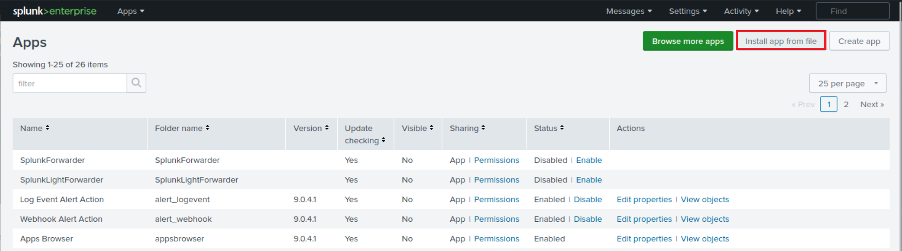

*Panel de Apps de Splunk — instalación del add-on de Sysmon vía "Install app from file".*
  

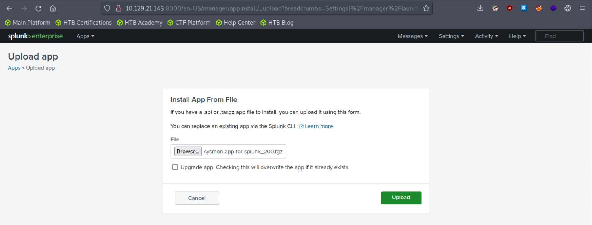
*Subida del paquete `sysmon-app-for-splunk_200.tgz`.*

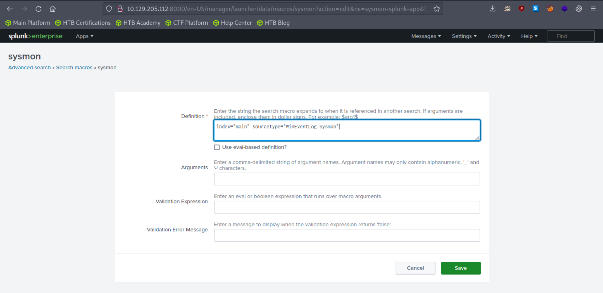
*Macro `` `sysmon` `` definido como `index="main" sourcetype="WinEventLog:Sysmon"`, usado como base de todas las consultas del informe.*

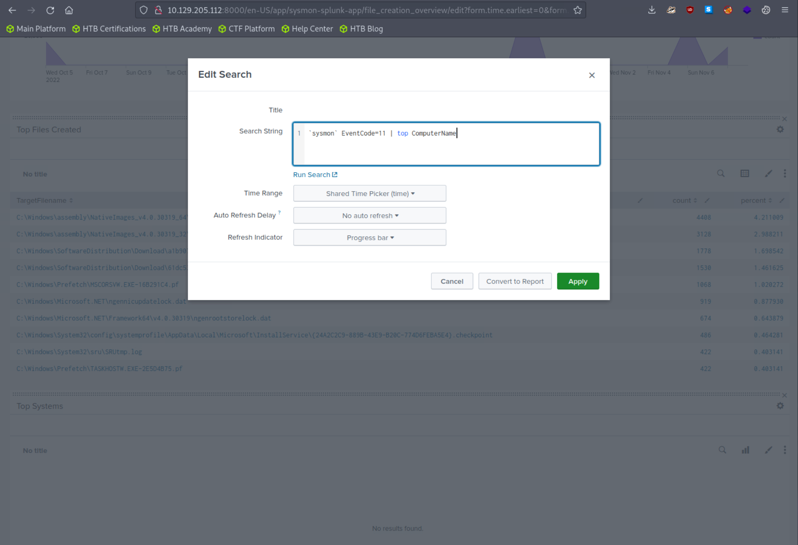
*Dashboard de referencia (`EventCode=11 | top ComputerName`) usado durante la fase de reconocimiento inicial del entorno.*

---
## 3. Línea de Tiempo del Incidente

  
| Fecha / Hora (local)     | Evento / Técnica                          | Host Afectado                               | Usuario / Contexto                                                        | Detalles Técnicos / Comando                                                                                                                                                                           |
| :----------------------- | :---------------------------------------- | :------------------------------------------ | :------------------------------------------------------------------------ | :---------------------------------------------------------------------------------------------------------------------------------------------------------------------------------------------------- |
| **2022-11-06**, 11:52:41 | **Primer volcado de LSASS**[cite: 1]      | `DESKTOP-EGSS5IS`[cite: 1]                  | `NT AUTHORITY\SYSTEM` (proceso), `DESKTOP-EGSS5IS\waldo` (padre)[cite: 1] | Ejecución de: <br>`cmd.exe /c rundll32.exe comsvcs.dll, MiniDump 656 C:\Temp\lsass.dmp full`[cite: 1]. Lanzado desde un proceso `rundll32.exe` padre (probable loader)[cite: 1].                      |
| **2022-11-06**, 11:52:51 | **Verificación del volcado**              | `DESKTOP-EGSS5IS`                           | `NT AUTHORITY\SYSTEM`                                                     | El atacante verifica la creación del archivo de salida ejecutando: <br>`cmd.exe /c dir C:\Temp`                                                                                                       |
| **2022-11-08**, 11:46:07 | **Repetición de acceso a LSASS**[cite: 1] | `DESKTOP-EGSS5IS`[cite: 1]                  | `NT AUTHORITY\SYSTEM`[cite: 1]                                            | Acceso anómalo a `lsass.exe` vía `rundll32.exe + comsvcs.dll` (mismo `CallTrace`). Indicio fuerte de persistencia/repetición[cite: 1].                                                                |
| **2022-11-08**, 12:40:13 | **Acceso Remoto (RDP)**[cite: 1]          | `DESKTOP-UN7T4R8.uniwaldo.local`[cite: 1]   | `UNIWALDO\waldo`[cite: 1]                                                 | Inicio de sesión interactiva de PowerShell (PID 11072), proceso padre `explorer.exe`, `TerminalSessionId=2` (Sesión RDP)[cite: 1].                                                                    |
| **2022-11-08**, 12:43:36 | **Ejecución DCSync #1**[cite: 1]          | `DESKTOP-UN7T4R8.uniwaldo.local`[cite: 1]   | `UNIWALDO\waldo`[cite: 1]                                                 | Se escribe en disco el archivo:<br>`C:\temp\20221108T1243_DCSYNC\20221108T1243_DCSync_NTLM_LOGFILE.txt`[cite: 1]                                                                                      |
| **2022-11-08**, ~12:43   | **Análisis manual de hashes #1**[cite: 1] | `DESKTOP-UN7T4R8.uniwaldo.local`[cite: 1]   | `UNIWALDO\waldo`[cite: 1]                                                 | El atacante abre el log del DCSync #1 con `notepad.exe` para revisar los hashes extraídos[cite: 1].                                                                                                   |
| **2022-11-08**, 12:46    | **Ejecución DCSync #2**                   | `DESKTOP-UN7T4R8.uniwaldo.local`            | `UNIWALDO\waldo`                                                          | Creación y posterior revisión vía bloc de notas del archivo:<br>`20221108T1246_DCSync_NTLM_LOGFILE.txt`                                                                                               |
| **2022-11-08**, 12:52    | **Ejecución DCSync #3 (Señuelo)**         | `DESKTOP-UN7T4R8.uniwaldo.local`            | `UNIWALDO\waldo`                                                          | Intento de evasión guardando la extracción con nombre legítimo:<br>`20221108T1252_DCSync_NTLM_CUSTOMER_Importfile_FINAL.txt`                                                                          |
| *Sin hora exacta*        | **Tanteo Manual / Evasión**               | `DESKTOP-UN7T4R8.uniwaldo.local` (probable) | `waldo`                                                                   | Múltiples intentos fallidos de ejecutar `rundll32 comsvcs.dll` con sintaxis variable (`,Start`, `,Sta`, `,Star`, con/sin comillas) intentando guardar el dump en `C:\Users\waldo\Downloads\file.dmp`. |
  
El nombre embebido `20221108T1243` corresponde al timestamp propio de la herramienta usada por el atacante para nombrar sus archivos de salida, y coincide exactamente con el `_time` del evento en Splunk — lo cual confirma que no hay desfase horario relevante entre la herramienta del atacante y los logs.
  

---

## 4. Hallazgos Técnicos Detallados

### 4.1 Hallazgo 1: Volcado inicial de LSASS con privilegios SYSTEM (T1003.001)
  
**Consulta SPL de partida:**

```bash
index="main" EventCode=10 lsass
| stats count by SourceImage
```

**Resultado (extracto):** de 238 eventos analizados, la gran mayoría corresponden a accesos legítimos (`msiexec.exe`, `csrss.exe`, `wininit.exe`, `Sysmon.exe`), pero se detectan **7 accesos desde `rundll32.exe`** (dos variantes de ruta) y **1 desde `notepad.exe`**, claramente fuera del patrón esperado.


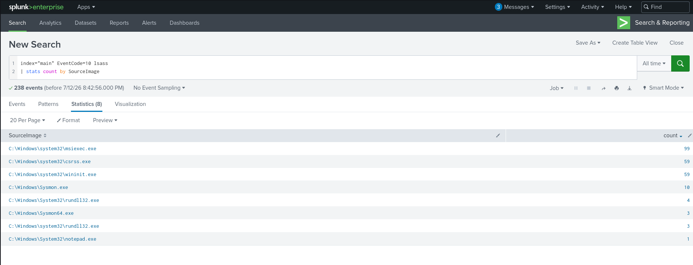

*`index="main" EventCode=10 lsass | stats count by SourceImage` — se identifican procesos anómalos accediendo a `lsass.exe`.*

**Pivoteo por host y franja horaria (`DESKTOP-EGSS5IS`, 11:52):**

```bash

index="main" host="DESKTOP-EGSS5IS" EventCode=1 "rundll32.exe" sourcetype="WinEventLog:Sysmon"

| eval hora_min=strftime(_time, "%H:%M")

| search hora_min="11:52"

| table _time, User, ParentImage, CommandLine

```

  

**Evidencia clave (evento de creación de proceso, `EventCode=1`, 2022-11-06 11:52:41):**


| Campo               | Valor                                                                                                              |
| :------------------ | :----------------------------------------------------------------------------------------------------------------- |
| `Image`             | `C:\Windows\System32\cmd.exe`                                                                                      |
| `CommandLine`       | `c:\windows\system32\cmd.exe /c rundll32.exe C:\Windows\System32\comsvcs.dll, MiniDump 656 C:\Temp\lsass.dmp full` |
| `CurrentDirectory`  | `C:\Users\waldo\Downloads\`                                                                                        |
| `User`              | `NT AUTHORITY\SYSTEM`                                                                                              |
| `TerminalSessionId` | `1`                                                                                                                |
| `ParentImage`       | `C:\Windows\System32\rundll32.exe`                                                                                 |
| `ParentCommandLine` | `C:\Windows\System32\rundll32.exe`                                                                                 |
| `ParentUser`        | `DESKTOP-EGSS5IS\waldo`                                                                                            |
  
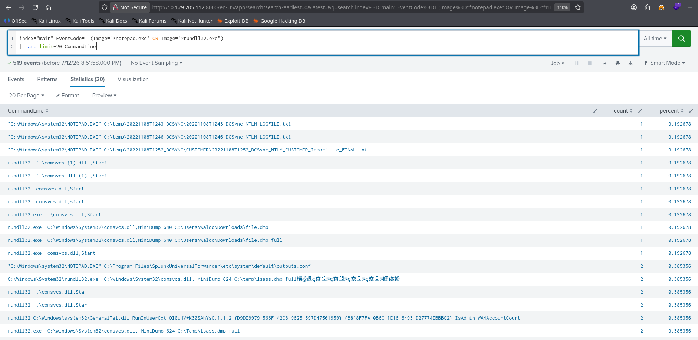

*Resultado del pivoteo , comando exacto de `MiniDump` y el `dir C:\Temp` de verificación posterior.*

  
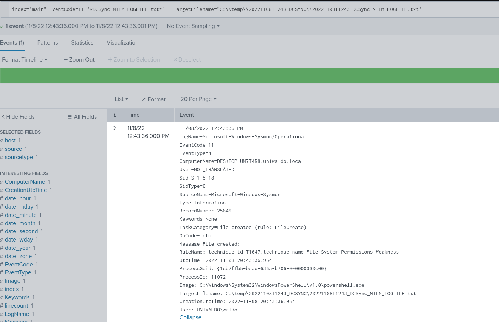

*Evento crudo (`EventCode=1`) mostrando `User=NT AUTHORITY\SYSTEM`, `ParentImage=rundll32.exe` y `ParentUser=DESKTOP-EGSS5IS\waldo`.*

  

**Análisis:** este es el evento más crítico del incidente. El comando volcó la memoria del proceso `lsass.exe` (PID `656`) a `C:\Temp\lsass.dmp` usando la función exportada `MiniDump` de `comsvcs.dll`, una técnica *fileless* que no requiere subir herramientas como Mimikatz al disco, ya que usa un binario firmado por Microsoft.

  
Dos detalles elevan la severidad de este hallazgo:

1. **El proceso corrió como `NT AUTHORITY\SYSTEM`**, no como el usuario `waldo`. Esto significa que, para este punto, el atacante ya había logrado ejecución de código con el máximo privilegio local, un paso de escalada de privilegios previo que **no quedó capturado** en las consultas actuales y debería ser objeto de una investigación adicional (posible tarea programada, servicio, exploit local, o herramienta tipo PsExec).

2. **El proceso padre es `rundll32.exe` ejecutándose desde `C:\Users\waldo\Downloads\`**, lo que sugiere que el usuario `waldo` (cuenta local) descargó y ejecutó un loader o script que, a su vez, lanzó `cmd.exe` con privilegios SYSTEM para hacer el volcado.
  

**Verificación inmediata por parte del atacante:**

```bash

CommandLine: c:\windows\system32\cmd.exe /c dir C:\Temp

```

El atacante listó el contenido de `C:\Temp` justo 10 segundos después (11:52:51), confirmando que estaba validando en vivo que el volcado se hubiera generado correctamente.


---

### 4.2 Hallazgo 2: Repetición del volcado de LSASS (persistencia / segundo intento)

**Consultas SPL:**

```bash

index="*main" sourcetype="WinEventLog:Sysmon" EventCode=10 lsass rundll32.exe

```

```bash

index="*main" sourcetype="WinEventLog:Sysmon" EventCode=10 TargetImage="*lsass*" SourceImage="*rundll32*" rundll32.exe CallTrace!="*UNKNOWN*"

```

  
Al comparar dos eventos `EventCode=10` (ProcessAccess) sobre el mismo host `DESKTOP-EGSS5IS`, se confirmó el **mismo patrón exacto de `CallTrace`** en dos fechas distintas:

| Fecha/Hora (UTC)        | SourceProcessId | TargetProcessId (lsass.exe) | SourceUser            | TargetUser            |
| ----------------------- | --------------- | --------------------------- | --------------------- | --------------------- |
| 2022-11-06 19:52:41.359 | 6648            | 656                         | `NT AUTHORITY\SYSTEM` | `NT AUTHORITY\SYSTEM` |
| 2022-11-08 19:46:07.171 | 1624            | 640                         | `NT AUTHORITY\SYSTEM` | `NT AUTHORITY\SYSTEM` |


**CallTrace (idéntico en ambos eventos, leído de derecha a izquierda, proceso origen a función invocada):**

```bash

rundll32.exe → comsvcs.dll (+220f2, MiniDump) → dbgcore.dll → KERNEL32.dll → ntdll.dll

```

  

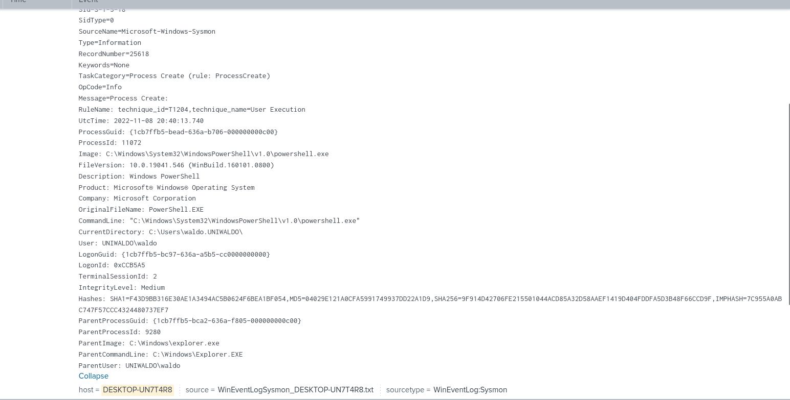

*`EventCode=10` : acceso de `rundll32.exe` a `lsass.exe` el 2022-11-08, con el `CallTrace` completo hacia `comsvcs.dll`.*

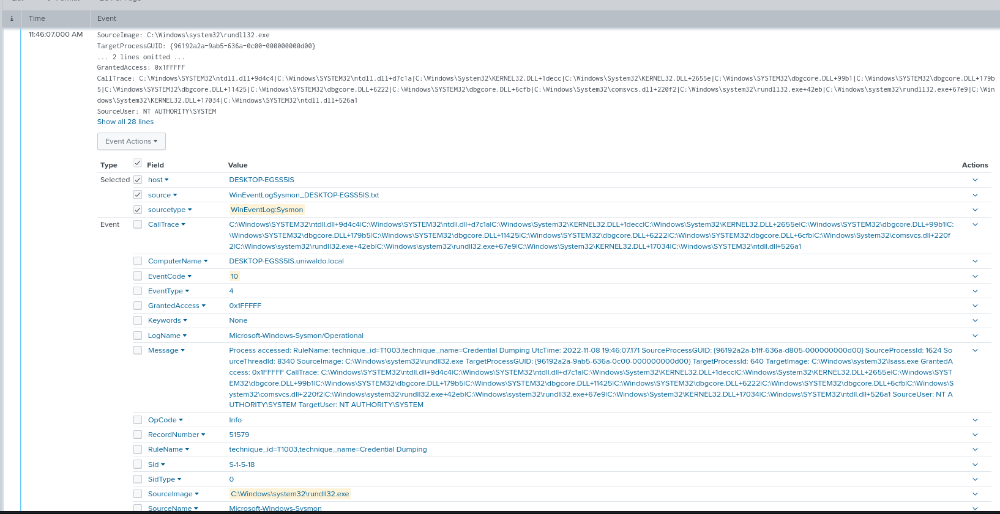

*Comparación lado a lado del mismo `CallTrace` en dos fechas distintas sobre `DESKTOP-EGSS5IS`, confirmando la repetición del ataque.*

  

**Análisis:** el `GrantedAccess=0x1FFFFF` (`PROCESS_ALL_ACCESS`) y el `RuleName` embebido por Sysmon (`technique_id=T1003,technique_name=Credential Dumping`) confirman en ambos eventos que se trató de un acceso completo al proceso `lsass.exe` con fines de extracción de credenciales. La repetición del mismo `CallTrace` en un intervalo de dos días, sobre el mismo host y con el mismo PID de destino recurrente (`lsass.exe`), descarta que se trate de un falso positivo o una coincidencia, y refuerza la hipótesis de **persistencia o repetición deliberada del ataque**.

---

### 4.3 Hallazgo 3: Revisión manual de credenciales exfiltradas y exportaciones múltiples de DCSync

**Consulta SPL:**

```bash

index="main" EventCode=1 (Image="*notepad.exe" OR Image="*rundll32.exe")

| rare limit=20 CommandLine

```

*(519 eventos totales analizados)*


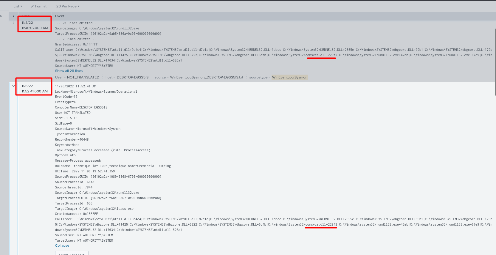

*Las tres exportaciones de DCSync abiertas con `notepad.exe` y las distintas variantes de `rundll32 comsvcs.dll` quedan visibles en un mismo resultado.*

**Hallazgos relevantes en el resultado:**

1. **Tres exportaciones DCSync distintas, en 9 minutos**, todas abiertas manualmente con `notepad.exe`:


```bash

   "C:\Windows\system32\NOTEPAD.EXE" C:\temp\20221108T1243_DCSYNC\20221108T1243_DCSync_NTLM_LOGFILE.txt

   "C:\Windows\system32\NOTEPAD.EXE" C:\temp\20221108T1246_DCSYNC\20221108T1246_DCSync_NTLM_LOGFILE.txt

   "C:\Windows\system32\NOTEPAD.EXE" C:\temp\20221108T1252_DCSYNC\CUSTOMER\20221108T1252_DCSync_NTLM_CUSTOMER_Importfile_FINAL.txt

```


   El tercer archivo usa un **nombre señuelo** (`CUSTOMER_Importfile_FINAL.txt`), disfrazando un volcado de credenciales como si fuera un archivo de importación de datos de cliente. Esto es un indicador de **intención de exfiltración encubierta**, pensado para pasar desapercibido ante una revisión superficial de la carpeta `C:\temp\`.


2. **Múltiples variantes de sintaxis de `rundll32 comsvcs.dll`**, todas apuntando a `C:\Users\waldo\Downloads\file.dmp`:

```bash


   rundll32 ".\comsvcs (1).dll",Start

   rundll32 ".\comsvcs.dll (1)",Start

   rundll32 comsvcs.dll,Start

   rundll32 comsvcs.dll,start

   rundll32.exe .\comsvcs.dll,Start

   rundll32.exe C:\Windows\System32\comsvcs.dll,MiniDump 640 C:\Users\waldo\Downloads\file.dmp

   rundll32.exe C:\Windows\System32\comsvcs.dll,MiniDump 640 C:\Users\waldo\Downloads\file.dmp full
```


   La variación en la sintaxis (con y sin extensión `.dll` duplicada, mayúsculas/minúsculas en `Start`/`start`, con y sin el parámetro `full`) sugiere **tanteo manual del atacante**, probablemente ejecutando el comando de forma interactiva y ajustándolo hasta obtener el resultado esperado, más que un script automatizado y depurado de antemano.

  

3. Se observaron eventos con caracteres corruptos/ilegibles en el `CommandLine` (p. ej. `rundll32.exe C:\windows\System32\comsvcs.dll, MiniDump 624 C:\temp\lsass.dmp full` seguido de bytes no imprimibles) esto podría indicar un intento de ofuscación del comando o simplemente un artefacto de codificación en el log, se recomienda revisar el evento crudo (`_raw`) para descartar manipulación deliberada.

  
`notepad.exe` no ejecutó ningún binario malicioso: fue usado como visor legítimo para que el atacante **revisara manualmente** el contenido de las credenciales ya exportadas antes de decidir su siguiente paso (exfiltración, uso para movimiento lateral, etc.).

  

---

### 4.4 Hallazgo 4, Sesión interactiva de PowerShell vía RDP (origen del DCSync)

**Campos relevantes del evento (`EventCode=1`, `ProcessId=11072`, 2022-11-08 20:40:13 UTC):**

  

| Campo                   | Valor                                                         | Significado                                                     |
| ----------------------- | ------------------------------------------------------------- | --------------------------------------------------------------- |
| `Image`                 | `C:\Windows\System32\WindowsPowerShell\v1.0\powershell.exe`   | Consola nativa de PowerShell                                    |
| `CommandLine`           | `"C:\Windows\System32\WindowsPowerShell\v1.0\powershell.exe"` | Sin parámetros → sesión interactiva, no un one-liner registrado |
| `User`                  | `UNIWALDO\waldo`                                              | Cuenta de dominio comprometida                                  |
| `ComputerName` / `host` | `DESKTOP-UN7T4R8.uniwaldo.local`                              | Endpoint afectado                                               |
| `ParentImage`           | `C:\Windows\explorer.exe` (PID `9280`)                        | Shell gráfico de Windows                                        |
| `TerminalSessionId`     | `2`                                                           | Sesión remota (≠ 0 = consola local)                             |
| `IntegrityLevel`        | `Medium`                                                      | Sin elevación (UAC) en este proceso puntual                     |
  
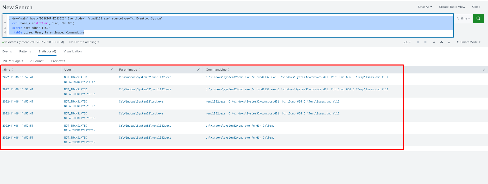

*Evento crudo mostrando `CommandLine` limpio, `ParentImage=explorer.exe` y `TerminalSessionId=2`.*

**Evento de creación de archivo asociado (`EventCode=11`, 2022-11-08 20:43:36 UTC):**

```bash

Image: C:\Windows\System32\WindowsPowerShell\v1.0\powershell.exe

TargetFilename: C:\temp\20221108T1243_DCSYNC\20221108T1243_DCSync_NTLM_LOGFILE.txt

ProcessId: 11072   (mismo PID que la sesión interactiva)

User: UNIWALDO\waldo

```

  
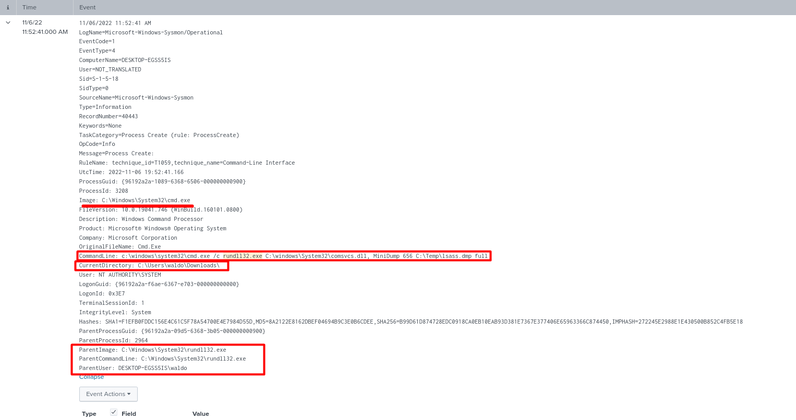

*`EventCode=11`, `powershell.exe` (PID 11072) crea el archivo de salida del DCSync, confirmando el vínculo con la sesión interactiva.*

  

**Análisis:** el `ProcessId` idéntico (`11072`) entre el evento de inicio de PowerShell (`EventCode=1`, 12:40:13) y el evento de creación del archivo DCSync (`EventCode=11`, 12:43:36) confirma que **fue la misma sesión interactiva** la que, 3 minutos después de abrirse, generó el archivo de salida del DCSync, es decir, el operador tecleó manualmente el comando de DCSync (o lo pegó desde un script preparado) directamente en la consola, sin dejar rastro de parámetros en el `CommandLine` del proceso padre.
  

La combinación `ParentImage=explorer.exe` + `TerminalSessionId=2` es un indicador fuerte de que el atacante abrió la consola manualmente tras conectarse por **RDP** con las credenciales de `waldo`, en lugar de usar un mecanismo de ejecución remota silenciosa (WMI, PsExec, WinRM), lo cual sugiere una intrusión con **acceso interactivo directo al escritorio**.

---

## 5. Indicadores de Compromiso (IOC)


| Tipo | Valor |
|---|---|
| Usuario de dominio comprometido | `UNIWALDO\waldo` |
| Cuenta local comprometida | `DESKTOP-EGSS5IS\waldo` |
| Host — DCSync / revisión de credenciales | `DESKTOP-UN7T4R8.uniwaldo.local` |
| Host — Volcado de LSASS | `DESKTOP-EGSS5IS` |
| Ruta de staging DCSync | `C:\temp\20221108T124[3\|6\|2]_DCSYNC\` |
| Patrón de nombre señuelo | `*_CUSTOMER_Importfile_FINAL.txt` |
| Ruta de volcado LSASS #1 | `C:\Temp\lsass.dmp` |
| Ruta de volcado LSASS #2 | `C:\Users\waldo\Downloads\file.dmp` |
| DLL abusada | `comsvcs.dll` (función exportada `MiniDump`) |
| Binarios LOLBin | `rundll32.exe`, `cmd.exe`, `powershell.exe`, `notepad.exe` |
| Proceso objetivo | `lsass.exe` (PIDs `656` y `640` en distintas ejecuciones) |
| Directorio de origen sospechoso | `C:\Users\waldo\Downloads\` (posible loader descargado) |
| `TerminalSessionId` remoto | `2` (RDP, host `DESKTOP-UN7T4R8`) |
| Fechas de actividad LSASS dump | 2022-11-06 y 2022-11-08 (mismo host, mismo patrón) |

---
## 6. Mapeo MITRE ATT&CK

  
| Táctica                             | Técnica                                                | ID        | Confirmado por                                                      |
| ----------------------------------- | ------------------------------------------------------ | --------- | ------------------------------------------------------------------- |
| Acceso Inicial / Movimiento Lateral | Remote Desktop Protocol                                | T1021.001 | `TerminalSessionId=2`, `ParentImage=explorer.exe`                   |
| Ejecución                           | Command and Scripting Interpreter: PowerShell          | T1059.001 | Sesión interactiva PID 11072                                        |
| Ejecución                           | Windows Command Shell                                  | T1059.003 | `cmd.exe /c rundll32.exe...`                                        |
| Ejecución                           | System Binary Proxy Execution: Rundll32                | T1218.011 | Múltiples invocaciones de `rundll32.exe`                            |
| Escalada de Privilegios             | *(vector no identificado, pendiente de investigación)* | —         | Proceso de dump corre como `NT AUTHORITY\SYSTEM` sin origen claro   |
| Acceso a Credenciales               | OS Credential Dumping: LSASS Memory                    | T1003.001 | Sysmon `RuleName=technique_id=T1003`, `CallTrace` con `comsvcs.dll` |
| Acceso a Credenciales               | OS Credential Dumping: DCSync                          | T1003.006 | 3 archivos `*_DCSync_NTLM_*.txt`                                    |
| Colección                           | Data Staged: Local Data Staging                        | T1074.001 | Carpetas `C:\temp\*_DCSYNC\`                                        |
| Evasión de Defensas                 | Masquerading: Match Legitimate Name or Location        | T1036     | Nombre señuelo `CUSTOMER_Importfile_FINAL.txt`                      |
| Descubrimiento / Post-explotación   | Revisión manual de archivos exfiltrados vía LOLBin     | —         | `notepad.exe` abriendo logs de credenciales                         |
 

---

## 7. Impacto

- Posible exposición de hashes NTLM de múltiples cuentas del dominio `uniwaldo.local` (consecuencia típica de un DCSync exitoso, agravada por haberse repetido 3 veces).

- Volcado completo de memoria de `lsass.exe` con privilegios SYSTEM, lo que puede exponer credenciales en texto claro o tickets Kerberos además de hashes NTLM.

- Evidencia de una **escalada de privilegios previa no identificada** en `DESKTOP-EGSS5IS`, lo que amplía la superficie de investigación pendiente.

- Riesgo de exfiltración ya materializado o inminente, dado el uso de un nombre de archivo señuelo diseñado específicamente para pasar desapercibido.

- Evidencia de persistencia/repetición en un intervalo de 2 días, lo que sugiere que el atacante pudo mantener acceso al entorno más allá del evento inicial detectado.

---
## 8. Recomendaciones

1. **Contención inmediata:** aislar `DESKTOP-EGSS5IS` y `DESKTOP-UN7T4R8.uniwaldo.local` de la red, preservar los archivos `C:\Temp\lsass.dmp` y `C:\Users\waldo\Downloads\file.dmp` para análisis forense antes de eliminarlos.

2. **Rotación de credenciales:** forzar cambio de contraseña de `UNIWALDO\waldo`, la cuenta local `DESKTOP-EGSS5IS\waldo`, y evaluar rotar el `krbtgt` del dominio dado el alcance del DCSync.

3. **Investigar el vector de escalada a SYSTEM** en `DESKTOP-EGSS5IS`: revisar tareas programadas, servicios instalados recientemente, uso de PsExec/WMI, y el binario descargado en `C:\Users\waldo\Downloads\` que actuó como proceso padre del volcado.

4. **Revisión de permisos DCSync:** auditar qué cuentas tienen delegados `Replicating Directory Changes` / `Replicating Directory Changes All`, revocar los innecesarios.

5. **Hardening de LSASS:** habilitar **LSA Protection (RunAsPPL)** y **Credential Guard** para bloquear el volcado vía `comsvcs.dll`.

6. **Detección proactiva:** crear una alerta persistente en Splunk para `EventCode=10` con `TargetImage=*lsass*` excluyendo procesos de seguridad conocidos, y otra para creación de archivos con patrones `*DCSync*` o nombres con extensiones de importación de datos que no correspondan a procesos legítimos de negocio.

7. **RDP:** restringir el acceso mediante VPN + MFA, deshabilitarlo hacia hosts críticos desde redes no confiables.

8. **Threat hunting continuo:** ampliar el pivoteo por el patrón horario `11:52`/`11:46` y por el `CallTrace` de `comsvcs.dll` al resto del entorno, para descartar más hosts afectados en el mismo intervalo de fechas.
 
---
## 9. Consultas SPL de Referencia

```bash

# Macro base usado en todas las búsquedas

[macro: sysmon] index="main" sourcetype="WinEventLog:Sysmon"

  

# Accesos anómalos a LSASS por proceso origen

index="main" EventCode=10 lsass

| stats count by SourceImage

  

# Comportamiento anómalo de LOLBins (notepad / rundll32)

index="main" EventCode=1 (Image="*notepad.exe" OR Image="*rundll32.exe")

| rare limit=20 CommandLine

  

# Acceso sospechoso a LSASS vía rundll32

index="*main" sourcetype="WinEventLog:Sysmon" EventCode=10 lsass rundll32.exe

  

# Refinado con CallTrace válido

index="*main" sourcetype="WinEventLog:Sysmon" EventCode=10 TargetImage="*lsass*" SourceImage="*rundll32*" rundll32.exe CallTrace!="*UNKNOWN*"

  

# Pivoteo por host y franja horaria (confirma el volcado inicial del 2022-11-06)

index="main" host="DESKTOP-EGSS5IS" EventCode=1 "rundll32.exe" sourcetype="WinEventLog:Sysmon"

| eval hora_min=strftime(_time, "%H:%M")

| search hora_min="11:52"

| table _time, User, ParentImage, CommandLine

```

  

---

## 10. Conclusión
 
Este threat hunting reconstruyó una cadena de ataque completa de robo de credenciales usando exclusivamente binarios legítimos de Windows (LOLBins): desde el acceso remoto interactivo vía RDP, pasando por el volcado de memoria de LSASS con privilegios SYSTEM en un segundo host, hasta la ejecución repetida de DCSync y la revisión manual de las credenciales exportadas, incluyendo un intento de exfiltración disfrazado bajo un nombre de archivo señuelo. La correlación de `ProcessId` entre eventos `EventCode=1` y `EventCode=11`, junto con el análisis del `CallTrace` en eventos `EventCode=10`, resultó clave para confirmar la relación causa-efecto entre procesos y descartar falsos positivos, demostrando el valor de un enfoque de detección basado en comportamiento por encima de la dependencia de firmas de malware.
 
**Líneas abiertas de investigación:** el vector exacto de escalada a `NT AUTHORITY\SYSTEM` en `DESKTOP-EGSS5IS` no quedó cubierto por el alcance de esta búsqueda y debería ser el siguiente paso del análisis.
 
---
