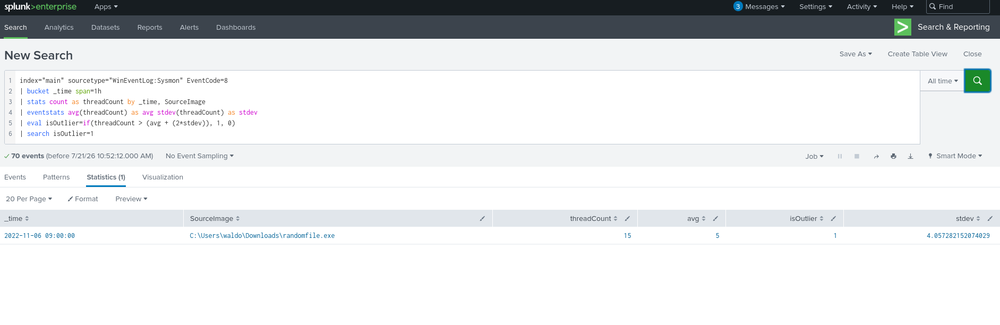
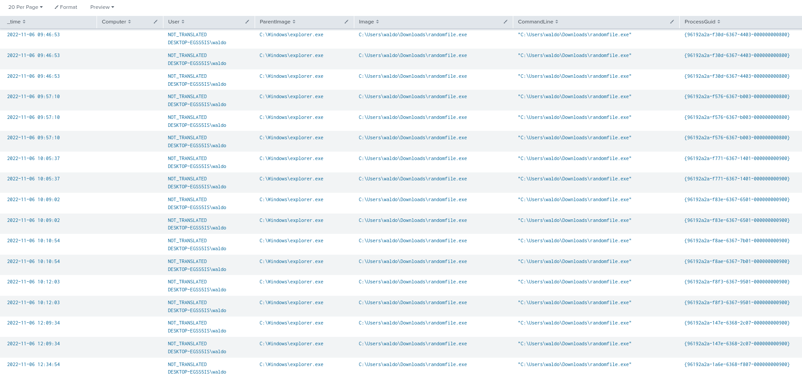
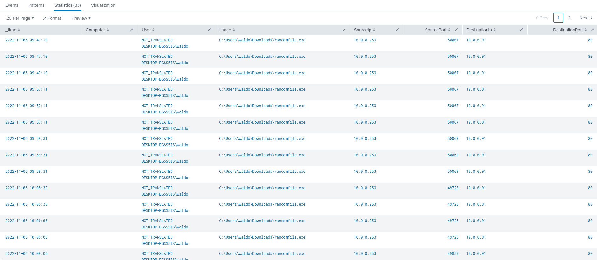
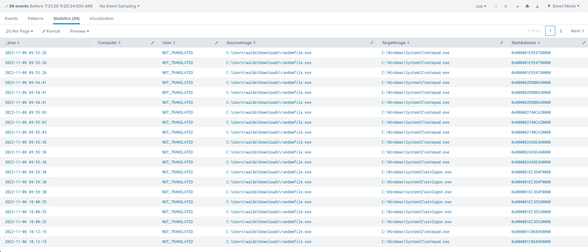
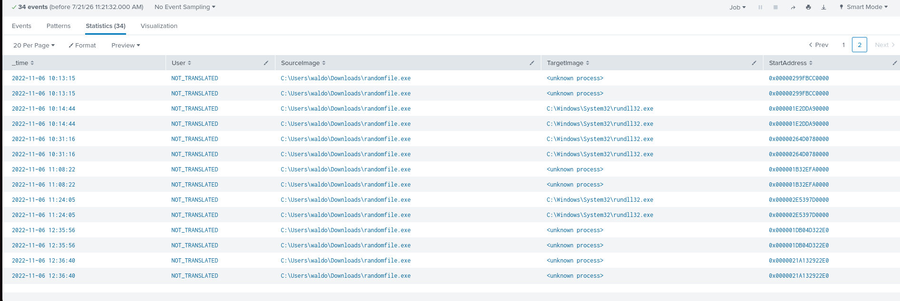

**Clasificación:** Confidencial – Uso Interno
**ID de Incidente:** IR-2026-0305-PROCINJ
**Fecha de Emisión del Reporte:** 2026-03-05
**Analista Responsable:** Maxi — Threat Hunter / SOC
**Fuente de Datos:** Splunk Enterprise (Sysmon Event Logs)
**Host Afectado:** DESKTOP-EG55S1S
**Usuario Involucrado:** waldo

**Técnicas MITRE ATT&CK:** 
[T1055 – Process Injection](https://attack.mitre.org/techniques/T1055/) 
[T1071.001 – Application Layer Protocol: Web Protocols](https://attack.mitre.org/techniques/T1071/001/)


---

## 1. Resumen Ejecutivo

Durante actividades de **threat hunting** proactivo sobre los logs de Sysmon centralizados en **Splunk**, se identificó la ejecución de un binario no catalogado (`randomfile.exe`) en el equipo `DESKTOP-EG55S1S`, asociado al usuario `waldo`. El análisis de la cadena de eventos confirma que el artefacto ejecutó **inyección de código en memoria** sobre procesos legítimos del sistema operativo (`notepad.exe`, `rundll32.exe`, `winlogon.exe`) y estableció **comunicación saliente periódica** con un host interno (`10.0.0.91`) por el puerto **80/TCP**, consistente con un patrón de beaconing hacia infraestructura de Comando y Control (C2).


El binario no dejó artefactos secundarios en disco, operando enteramente en memoria (*fileless execution*), lo que reduce significativamente su visibilidad ante soluciones de seguridad basadas en firmas y refuerza la necesidad de detección basada en comportamiento (behavioral analytics).


**Severidad:** Alta
**Estado:** Contenido / En investigación de alcance lateral
**Impacto potencial:** Ejecución de código arbitrario, persistencia encubierta, exfiltración de datos o pivoteo hacia otros activos de la red interna.

---

## 2. Cadena de Ataque (Kill Chain)

| Fase (Cyber Kill Chain) | Observación                                                                                                                                                   |
| ----------------------- | ------------------------------------------------------------------------------------------------------------------------------------------------------------- |
| Delivery                | Archivo alojado directamente en `Downloads` del usuario (vector de entrega no confirmado en el alcance del log: posible descarga vía navegador, USB o correo) |
| Execution               | Ejecución manual por doble clic desde el Explorador de Windows                                                                                                |
| Defense Evasion         | Ejecución fileless — sin escritura de payloads secundarios en disco                                                                                           |
| Command & Control       | Beaconing HTTP recurrente hacia `10.0.0.91:80`                                                                                                                |
| Actions on Objective    | Inyección de hilos remotos (`CreateRemoteThread`) sobre procesos legítimos del sistema                                                                        |

---

## 3. Metodología de Detección

La detección se originó a partir de una consulta de *outlier detection* estadístico sobre el volumen de eventos de creación de hilos remotos (**Sysmon EventCode 8**), utilizando una desviación estándar de +2σ sobre la línea base horaria de cada `SourceImage`:

```bash

index="main" sourcetype="WinEventLog:Sysmon" EventCode=8
| bucket _time span=1h
| stats count as threadCount by _time, SourceImage
| eventstats avg(threadCount) as avg stdev(threadCount) as stdev
| eval isOutlier=if(threadCount > (avg + (2*stdev)), 1, 0)
| search isOutlier=1

```

Esta consulta permite aislar procesos cuyo comportamiento de inyección de hilos se desvía significativamente del patrón habitual del entorno, sin depender de firmas o listas de indicadores conocidos, un enfoque efectivo frente a binarios no catalogados previamente.




---

## 4. Análisis Forense Detallado

### 4.1 Origen y Ejecución Inicial (Sysmon EventCode 1)

**Objetivo del análisis:** establecer el vector de ejecución, el usuario responsable, el proceso padre y la línea de comandos exacta.
```bash

index="main" sourcetype="WinEventLog:Sysmon" EventCode=1 Image="*randomfile.exe*"
| table _time, Computer, User, ParentImage, Image, CommandLine, ProcessGuid
| sort _time

```





**Hallazgos:**

| Campo                          | Valor                                                        |
| ------------------------------ | ------------------------------------------------------------ |
| Timestamp de primera ejecución | 2022-11-06 09:46:53                                          |
| Usuario                        | `DESKTOP-EG55S1S\waldo`                                      |
| Proceso padre                  | `C:\Windows\explorer.exe`                                    |
| Ruta del binario               | `C:\Users\waldo\Downloads\randomfile.exe`                    |
| Línea de comandos              | `"C:\Users\waldo\Downloads\randomfile.exe"` (sin argumentos) |

**Interpretación:** el proceso padre `explorer.exe` confirma ejecución interactiva por parte del usuario (**doble clic**), descartando lanzamiento automatizado vía script, tarea programada o servicio en segundo plano. El archivo residía en la carpeta de descargas, un vector común de ingesta de artefactos no verificados.

---

### 4.2 Actividad de Red y Comunicación C2 (Sysmon EventCode 3)

**Objetivo del análisis:** determinar si el binario estableció comunicación con infraestructura externa o interna sospechosa, y caracterizar el patrón de tráfico.

```bash
index="main" sourcetype="WinEventLog:Sysmon" EventCode=3 Image="*randomfile.exe*"
| table _time, Computer, User, Image, SourceIp, SourcePort, DestinationIp, DestinationPort, DestinationHostname
| sort _time
```




**Hallazgos:**

| Campo | Valor |
|---|---|
| IP origen | `10.0.0.253` (host comprometido) |
| IP destino | `10.0.0.91` |
| Puerto destino | `80/TCP` (HTTP, sin cifrar) |
| Patrón temporal | Ráfagas de conexión recurrentes (09:47, 09:57, 09:59, 10:05...) |

**Interpretación:** el patrón de conexiones periódicas y de corta duración es característico de un mecanismo de **beaconing / keep-alive** hacia un servidor de Comando y Control. El uso de HTTP en texto plano sobre el puerto estándar 80 sugiere un intento de camuflar el tráfico malicioso dentro del tráfico web legítimo del entorno, más que evadir inspección profunda de paquetes (DPI).

  

---

### 4.3 Persistencia y Artefactos en Disco (Sysmon EventCode 11)

**Objetivo del análisis:** confirmar si el binario descargó, escribió o desplegó payloads secundarios, scripts o mecanismos de persistencia.

```bash

index="main" sourcetype="WinEventLog:Sysmon" EventCode=11 Image="*randomfile.exe*"
| table _time, Computer, User, Image, TargetFilename
| sort _time
```
**Resultado:** sin coincidencias.

**Interpretación:** la ausencia de eventos EventCode 11 asociados al proceso es un hallazgo forense relevante — confirma que `randomfile.exe` operó como una amenaza **fileless**, sin dejar payloads persistentes en el sistema de archivos. Esto tiene implicancias directas para la estrategia de erradicación: no basta con eliminar el binario original, ya que la amenaza pudo no depender de artefactos en disco para su ejecución continuada mientras el proceso permaneció activo en memoria.

---

### 4.4 Inyección de Procesos (Sysmon EventCode 8)

**Objetivo del análisis:** identificar los procesos víctima y las direcciones de memoria utilizadas durante la inyección de hilos remotos.

```bash

index="main" sourcetype="WinEventLog:Sysmon" EventCode=8 SourceImage="*randomfile.exe*"
| table _time, Computer, User, SourceImage, TargetImage, StartAddress
| sort _time

```







**Interpretación:** la inyección sobre procesos legítimos del sistema operativo (`notepad.exe`, `rundll32.exe`, `winlogon.exe`) es una técnica de **defense evasion / process injection** orientada a ejecutar código malicioso bajo la identidad de un proceso confiable, dificultando su detección por soluciones EDR/AV basadas en reputación de procesos y complicando el análisis de causa raíz durante la respuesta al incidente.

  

---

## 5. Indicadores de Compromiso (IOC)

| Tipo | Valor | Contexto |
|---|---|---|
| Nombre de archivo | `randomfile.exe` | Binario ejecutado por el usuario |
| Ruta de archivo | `C:\Users\waldo\Downloads\randomfile.exe` | Ubicación de origen |
| IP de C2 | `10.0.0.91` | Destino de beaconing HTTP |
| Puerto | `80/TCP` | Canal de comunicación C2 |
| Host afectado | `DESKTOP-EG55S1S` (10.0.0.253) | Endpoint comprometido |
| Procesos víctima de inyección | `notepad.exe`, `rundll32.exe`, `winlogon.exe` | Procesos legítimos utilizados como huésped |

---
## 6. Mapeo MITRE ATT&CK

| Táctica | Técnica | ID | Evidencia |
|---|---|---|---|
| Execution | User Execution: Malicious File | T1204.002 | Ejecución manual desde `explorer.exe` |
| Defense Evasion | Process Injection | T1055 | EventCode 8 — `CreateRemoteThread` sobre múltiples procesos |
| Command and Control | Application Layer Protocol: Web Protocols | T1071.001 | Beaconing HTTP a `10.0.0.91:80` |
| Defense Evasion | Fileless / In-Memory Execution | T1620 (Reflective Code Loading, si aplica) | Ausencia de eventos EventCode 11 |

---

## 7. Impacto y Análisis de Riesgo

- **Confidencialidad:** riesgo medio-alto ante posible exfiltración de datos a través del canal C2 activo.
- **Integridad:** riesgo alto — la inyección en `winlogon.exe` compromete un proceso crítico del sistema operativo, con potencial de escalamiento de privilegios.
- **Disponibilidad:** riesgo bajo en el estado actual, sin evidencia de comportamiento destructivo o ransomware.
- **Alcance lateral:** pendiente de confirmar si `10.0.0.91` corresponde a otro activo interno comprometido (pivote) o a un gateway hacia infraestructura externa.

---
## 8. Recomendaciones

1. **Contención inmediata:** aislar `DESKTOP-EG55S1S` de la red y bloquear comunicación hacia `10.0.0.91` a nivel de firewall/proxy.
2. **Investigación de `10.0.0.91`:** determinar su naturaleza (host interno comprometido, servidor legítimo abusado, o infraestructura C2 propiamente dicha) mediante análisis de tráfico y logs del propio host.
3. **Threat hunting retroactivo:** ejecutar la misma consulta de detección por desviación estándar (EventCode 8) contra todo el entorno para identificar otros hosts afectados por la misma familia de malware.
4. **Erradicación:** dado el comportamiento fileless, priorizar el análisis de memoria (memory forensics) y reinicio controlado del endpoint sobre la simple eliminación del binario.
5. **Detección continua:** crear una regla de correlación permanente en el SIEM basada en la consulta de outliers de EventCode 8, con alertamiento automático ante nuevas desviaciones >2σ.
6. **Hardening:** evaluar políticas de restricción de ejecución (AppLocker / WDAC) sobre binarios no firmados ejecutados desde `Downloads`.

---
## 9. Conclusión
El incidente corresponde a un compromiso confirmado mediante técnicas de **process injection** y **comunicación C2 vía HTTP**, ejecutado a partir de interacción directa del usuario con un binario no verificado. La naturaleza fileless del artefacto y el uso de procesos legítimos como huésped evidencian un nivel de sofisticación orientado a evadir controles tradicionales, reforzando el valor de las capacidades de detección basadas en comportamiento y análisis estadístico sobre los logs de Sysmon como complemento a las soluciones EDR/AV del entorno.