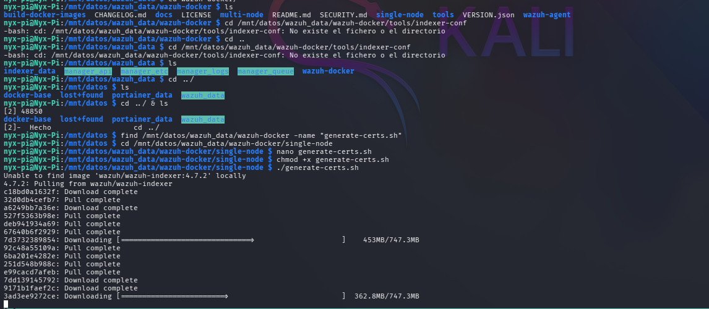
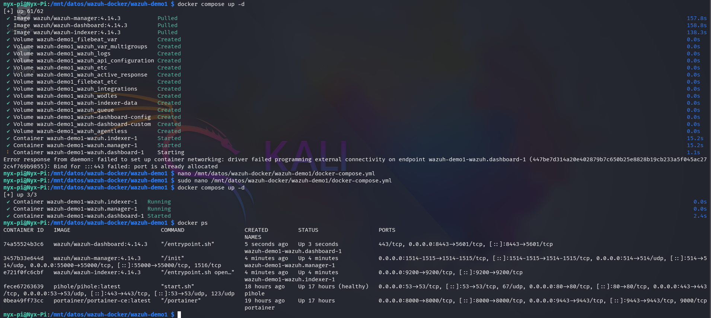
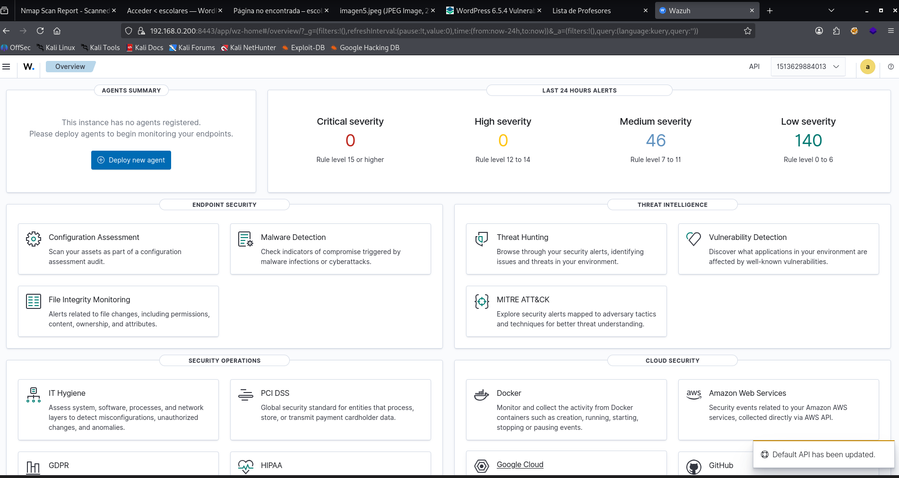
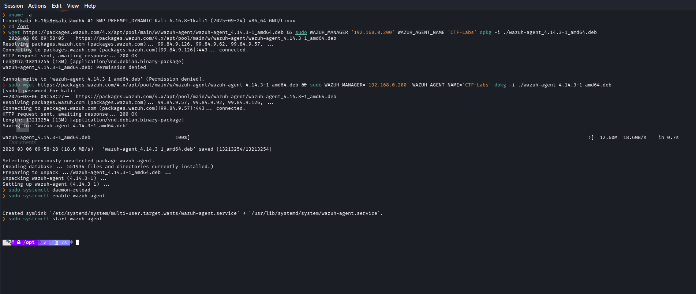
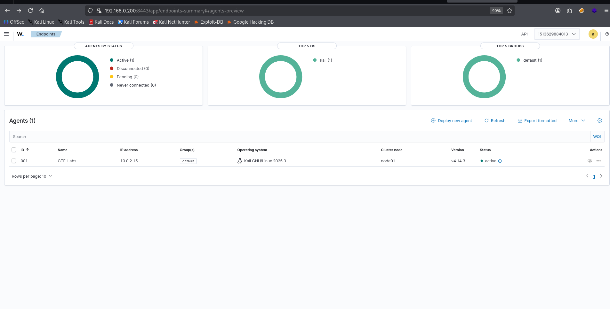

### Documentacion del Proyecto: Laboratorio SIEM Casero con Wazuh en Raspberry Pi 5

**Autor:** Maximiliano Barcia
**Fecha:** 31-08-2026
**Version:** 3.0 (Con repositorio publico y scripts automatizados)
**Repositorio:** [github.com/MaxiBarcia/wazuh-home-labs](https://github.com/MaxiBarcia/wazuh-home-labs)

---

#### 1. Resumen Ejecutivo

Este documento describe la implementacion de un laboratorio de seguridad (SIEM) en un entorno domestico utilizando una Raspberry Pi 5 como servidor central y una maquina virtual (CTF-Labs) como objetivo de pruebas.

El objetivo principal era centralizar y analizar logs de seguridad, simulando ataques para comprender el flujo de trabajo de un analista de SOC (Security Operations Center). El sistema se basa en **Wazuh**, una plataforma de seguridad de codigo abierto.

El proyecto incluye la resolucion de problemas criticos de compatibilidad ARM64, permisos en almacenamiento externo y la creacion de un repositorio de GitHub con scripts automatizados para que cualquiera pueda replicar el laboratorio.

**Novedades de la version 3.0:**
- Repositorio publico en GitHub con estructura profesional
- Scripts automatizados de despliegue (setup-pi.sh, auto_deploy_wazuh.sh, verify.sh)
- Documentacion tecnica completa (architecture.md, troubleshooting.md)
- Configuraciones listas para usar (ossec.conf, docker-compose.yml, .env.example)
- Banner renovado y assets organizados

---

#### 2. Objetivos del Proyecto

- Disenar e implementar un SIEM funcional en un entorno optimizado con bajo presupuesto
- Centralizar la recoleccion de logs desde un agente remoto
- Generar eventos de seguridad controlados (ataques simulados) y verificar su deteccion
- Aprender a navegar e investigar alertas en la interfaz de Wazuh/Kibana
- Documentar todo el proceso para futuras referencias y aprendizaje
- Publicar el proyecto como portfolio para SOC Analyst

---

#### 3. Arquitectura de la Red e Infraestructura

La infraestructura consta de los siguientes componentes principales:

| Componente | Hardware/SO | IP/Direccion | Rol Principal |
|---|---|---|---|
| Servidor Wazuh (Manager) | Raspberry Pi 5 (64GB SD + 2TB Disco Externo) con Raspberry Pi OS | 192.168.0.200:8443 | Centraliza logs, gestiona agentes, panel web Kibana |
| Maquina Objetivo (Agente) | Maquina Virtual (CTF-Labs - KALI) | 192.168.0.21 | Ejecuta el agente Wazuh y contenedores vulnerables |
| Maquina Atacante | Maquina Virtual (Nyx - Kali Linux) | 192.168.0.27 | Punto desde donde se lanzan los ataques simulados |
| Contenedor Vulnerable | Docker en CTF-Labs (Imagen "escolares") | 172.17.0.2 (Docker) | Contenedor con WordPress/Apache que actua como victima |

**Diagrama de flujo:**

```
Atacante (Nyx)            Objetivo (CTF-Labs)
Kali Linux                Kali Linux
192.168.0.27              192.168.0.21

Hydra + WPScan --------> Contenedor WordPress
                          172.17.0.2:8080
                          Logs -> /home/cft/logs_victima/
                                   |
                          Agente Wazuh (ID 006)
                          (lee logs del host)
                                   | puerto 1514/TCP
                          Wazuh Manager
                          Raspberry Pi 5
                          192.168.0.200:8443
                          Indexer + Dashboard
                          Disco 2TB EXT4 en /mnt/datos/
```

**Flujo de Datos:**

Los ataques desde Nyx hacia el contenedor en CTF-Labs generan logs en el contenedor. A traves de un volumen de Docker, estos logs se sincronizan con el sistema de archivos del host CTF-Labs en la ruta `/home/cft/logs_victima/`, donde el agente Wazuh los lee y los envia al Manager en la Raspberry Pi para su analisis y visualizacion.

---

#### 4. Configuracion e Instalacion Detallada

##### 4.1. Configuracion de la Raspberry Pi 5 (Servidor Wazuh)

**4.1.1. Instalacion del Sistema Operativo:**

- Se instalo Raspberry Pi OS (64-bit) en una tarjeta microSD de 64GB
- Se habilito SSH y se configuro IP estatica via nmtui
- Se ejecuto actualizacion completa del sistema

**4.1.2. Optimizacion del Almacenamiento:**

Un punto clave fue mover el "cerebro" de Docker (`/var/lib/docker`) al disco externo para que la SD de 64GB solo maneje el sistema operativo y el disco de 2TB soporte el desgaste de escritura de logs y contenedores.

```bash
# Formatear disco a EXT4 (crucial para permisos Linux)
sudo mkfs.ext4 /dev/sda1

# Montar por UUID
UUID=$(sudo blkid -s UUID -o value /dev/sda1)
echo "UUID=$UUID /mnt/datos ext4 defaults 0 2" | sudo tee -a /etc/fstab
sudo mount -a

# Mover Docker al disco externo
sudo systemctl stop docker
sudo mv /var/lib/docker /mnt/datos/docker-base
echo '{"data-root": "/mnt/datos/docker-base"}' | sudo tee /etc/docker/daemon.json
sudo systemctl start docker

# Verificar
docker info | grep "Docker Root Dir"
# Debe mostrar: /mnt/datos/docker-base
```

**4.1.3. Despliegue de Wazuh con Docker Compose:**

- Se utilizo el repositorio oficial de Wazuh Docker
- **Adaptacion para ARM64:** Se modifico el archivo `docker-compose.yml` para asegurar la compatibilidad con la arquitectura `arm64` de la Raspberry Pi 5
- Las versiones de Wazuh 4.7.2 son las primeras con soporte multi-arquitectura, eliminando la necesidad de especificar la plataforma manualmente
- El stack de Wazuh (Manager, Indexer, Dashboard) se desplego correctamente

```bash
git clone https://github.com/wazuh/wazuh-docker.git
cd wazuh-docker

# Generar certificados (atencion: el script oficial compila para amd64)
# En ARM64 se necesita intervencion manual con OpenSSL

# Copiar docker-compose.yml adaptado y desplegar
docker compose up -d
```

**4.1.4. Generacion de Certificados:**

Se utilizaron las herramientas oficiales para generar la infraestructura de clave publica (PKI) necesaria para la comunicacion segura entre los componentes.



*Captura: Descarga y generacion del script de certificados.*

**Nota tecnica para ARM64:** Debido a que el script de generacion original estaba compilado para `amd64`, en algunos pasos se intervino manualmente con **OpenSSL** para asegurar la compatibilidad con la arquitectura de la Raspberry Pi 5.

**4.1.5. Resolucion de Conflictos (Puerto 443):**

Al intentar levantar el stack, nos encontramos con el siguiente error:

```
Error response from daemon: Bind for 0.0.0.0:443 failed: port is already allocated
```

**Solucion:** Cambiamos el puerto del Dashboard de **443** a **8443** para evitar conflictos con Pi-hole o servicios del sistema que ya ocupaban el puerto HTTPS estandar.

```yaml
# En docker-compose.yml
wazuh.dashboard:
  ports:
    - "8443:443"
```

**4.1.6. Despliegue Final:**

Una vez ajustados los puertos y las arquitecturas, ejecutamos el despliegue final. A pesar de los avisos de "platform mismatch", la Raspberry Pi 5 ejecuto los binarios correctamente.

```bash
nyx-pi@Nyx-Pi:/mnt/datos/wazuh-docker/wazuh-demo1 $ docker compose up -d
```

**Estado de los Contenedores:**

Se verifico que todos los servicios estuvieran en estado `Up` (saludable).



*Captura: Contenedores de Wazuh corriendo junto a Pi-hole y Portainer.*

**4.1.7. Acceso al Dashboard:**

Finalmente, accedimos a la interfaz web a traves del puerto configurado (**8443**).



*Captura: Dashboard de Wazuh operativo tras el Health Check inicial.*

**Detalles Tecnicos de Acceso:**

- **URL:** `https://192.168.0.200:8443`
- **Credenciales por defecto:**
    - Usuario: `admin`
    - Password: `SecretPassword` (Configurado en el `.yml`)

**4.1.8. Configuracion de Persistencia en Almacenamiento Externo (SSD/HDD):**

Por defecto, los despliegues de Docker Wazuh utilizan **volumenes nombrados**, lo que almacena los datos en la particion raiz (tarjeta SD). Para un entorno de laboratorio SOC de larga duracion, es necesario realizar un **Bind Mount** hacia el disco externo.

**Preparacion de los Directorios Fisicos:**

```bash
sudo mkdir -p /mnt/datos/wazuh_data/{manager_etc,manager_logs,manager_queue,manager_api,indexer_data}
sudo chmod -R 777 /mnt/datos/wazuh_data
```

**Nota sobre permisos:** Durante el proceso, el comando `chown` no funcionaba correctamente en el disco externo, manteniendo los archivos con propietario `nyx-pi`. La solucion de emergencia fue dar permisos totales y forzar al contenedor a correr como root.

**Modificacion del docker-compose.yml:**

Se sustituyen las referencias de volumenes internos por rutas absolutas.

*Para Wazuh Indexer (Base de Datos):*

```yaml
wazuh.indexer:
  volumes:
    - /mnt/datos/wazuh_data/indexer_data:/usr/share/wazuh-indexer/data
```

*Para Wazuh Manager (Alertas y Logs):*

```yaml
wazuh.manager:
  user: "0:0"  # Forzado para evitar conflictos de permisos en el disco
  volumes:
    - /mnt/datos/wazuh_data/manager_logs:/var/ossec/logs
    - /mnt/datos/wazuh_data/manager_etc:/var/ossec/etc
```

**Aplicacion de Cambios y Limpieza:**

```bash
cd /mnt/datos/wazuh-docker/wazuh-demo1
docker compose down
docker volume prune -f
docker compose up -d
```

**Verificacion de Analista SOC:**

```bash
sudo ls -R /mnt/datos/wazuh_data/manager_logs/alerts/
```

- **Resultado esperado:** Presencia de la carpeta `2026/Mar/ossec-alerts-06.json`
- **Inspeccion de Docker:** Al ejecutar `docker inspect`, la seccion `Mounts` debe mostrar el `Source` apuntando a `/mnt/datos/...`

##### 4.2. Configuracion de la Maquina Objetivo (CTF-Labs - IP .21)

El objetivo era centralizar todos los logs, incluso de aplicaciones dentro de contenedores Docker.

**4.2.1. Instalacion del Agente Wazuh en el Host:**

- Se anadio el repositorio de Wazuh y se instalo el paquete `wazuh-agent`
- Se configuro el archivo `/var/ossec/etc/ossec.conf` para apuntar al manager (`<address>192.168.0.200</address>`)
- Se inicio y habilito el servicio con `systemctl`

```bash
curl -s https://packages.wazuh.com/key/GPG-KEY-WAZUH | sudo apt-key add -
echo "deb https://packages.wazuh.com/4.x/apt/ stable main" | sudo tee /etc/apt/sources.list.d/wazuh.list
sudo apt update
sudo apt install wazuh-agent -y
```



*Captura: Instalacion del agente Wazuh en la maquina CTF-Labs.*

**4.2.2. Configuracion de Red y Permisos:**

- Se ajustaron reglas de `iptables` para permitir el trafico necesario
- Se gestionaron permisos de usuarios y carpetas para que el agente Wazuh pudiera leer los logs del sistema y de las aplicaciones

**4.2.3. Estrategia de Recoleccion de Logs desde Contenedores:**

Este fue uno de los puntos mas importantes del proyecto. Para que el agente en el host pudiera ver los logs de los contenedores, se utilizo la funcionalidad de **volumenes de Docker**.

Al desplegar el contenedor vulnerable, se monto el volumen:

```bash
-v /home/cft/logs_victima:/var/log/apache2:rw
```

Esto sincroniza el directorio de logs de Apache dentro del contenedor con el directorio `/home/cft/logs_victima` en el host `CTF-Labs`. De esta forma, el agente Wazuh en el host puede monitorear los logs del contenedor como si fueran locales.

**4.2.4. Configuracion del Agente para Leer Logs:**

El archivo de configuracion completo del agente en `/var/ossec/etc/ossec.conf` se puede descargar del repositorio:

```bash
# Descargar la config del repositorio
curl -o /var/ossec/etc/ossec.conf https://raw.githubusercontent.com/MaxiBarcia/wazuh-home-labs/main/agent/ossec.conf
```

Los bloques clave para el monitoreo de logs de contenedores son:

```xml
<localfile>
  <log_format>apache</log_format>
  <location>/home/cft/logs_victima/access.log</location>
</localfile>
<localfile>
  <log_format>apache</log_format>
  <location>/home/cft/logs_victima/error.log</location>
</localfile>
<localfile>
  <log_format>syslog</log_format>
  <location>/home/cft/logs_victima/*.log</location>
</localfile>
```

**4.2.5. Verificacion de la Conexion del Agente:**

Una vez configurado, verificamos que el agente se conectaba correctamente al manager desde el dashboard de Wazuh.



*Captura: Agente 'CTF-Labs-nyx' conectado y activo en el panel de Wazuh.*

**4.2.6. Deshabilitacion del Enrollment Automatico:**

Para evitar que el agente intente registrarse automaticamente ignorando el archivo `client.keys`, se modifico el archivo de opciones internas:

```bash
# /var/ossec/etc/local_internal_options.conf
agent.auto_enroll=0
```

Esta configuracion tambien esta disponible en el repositorio en `agent/local_internal_options.conf`.

**4.2.7. Formato correcto del archivo client.keys:**

Un error critico fue que el archivo `client.keys` no tenia el formato correcto, causando errores de "Invalid password". La solucion fue:

```bash
echo "006:cft:any:CLAVE_GENERADA_EN_MANAGER" | sudo tee /var/ossec/etc/client.keys
```

El archivo debe tener exactamente el formato `ID:NAME:IP:KEY` con un salto de linea al final. El repositorio incluye un archivo de ejemplo en `agent/client.keys.example`.

**4.2.8. Script de Despliegue Automatizado de Contenedores Vulnerables:**

Se desarrollo un script personalizado `auto_deploy_wazuh.sh` que automatiza el despliegue de contenedores vulnerables con integracion directa de logs para Wazuh. El script completo esta disponible en el repositorio en `scripts/auto_deploy_wazuh.sh`.

**Caracteristicas clave del script:**

- Limpia contenedores e imagenes previas del mismo nombre
- Monta automaticamente los logs en `/home/cft/logs_victima/` (carpeta monitoreada por Wazuh)
- Establece permisos `root:wazuh` para que el agente pueda leer los logs
- Crea una red aislada para los contenedores
- Muestra la IP del contenedor desplegado
- Permite detener y limpiar todo con Ctrl+C

**Uso:**

```bash
chmod +x auto_deploy_wazuh.sh
sudo ./auto_deploy_wazuh.sh escolares.tar
```

**Salida esperada:**

```
Maquina desplegada, su direccion IP es --> 172.17.0.2
Los logs de Apache estan en: /home/cft/logs_victima
Presiona Ctrl+C cuando termines con la maquina para eliminarla
```

---

#### 5. Repositorio en GitHub

El proyecto completo esta disponible en GitHub como repositorio publico:

**URL:** [github.com/MaxiBarcia/wazuh-home-labs](https://github.com/MaxiBarcia/wazuh-home-labs)

**Estructura del repositorio:**

```
wazuh-home-labs/
├── README.md                       # Documentacion principal
├── LICENSE                         # MIT
├── .gitignore
├── docker/
│   ├── docker-compose.yml          # Stack Wazuh adaptado ARM64
│   └── .env.example                # Variables de entorno
├── agent/
│   ├── ossec.conf                  # Config del agente (con monitoreo de contenedores)
│   ├── local_internal_options.conf # Opciones internas (auto_enroll=0)
│   └── client.keys.example         # Formato de ejemplo
├── scripts/
│   ├── auto_deploy_wazuh.sh        # Despliega contenedor vulnerable con logs para Wazuh
│   ├── setup-pi.sh                 # Instalacion inicial RPi
│   └── verify.sh                   # Comandos de verificacion
├── attacks/
│   ├── hydra.sh                    # Ataque fuerza bruta Hydra
│   ├── wpscan.sh                   # Ataque fuerza bruta WPScan
│   └── wordlist-sample.txt         # Diccionario de ejemplo
└── docs/
    ├── architecture.md             # Diagrama detallado
    └── troubleshooting.md          # Problemas conocidos y soluciones
```

El README incluye badges de licencia, version de Wazuh y compatibilidad ARM64, ademas de instrucciones paso a paso, tabla de problemas comunes y enlaces al blog post.

---

#### 6. Simulacion de Ataques y Validacion

Para probar la deteccion del SIEM, se realizaron varios ataques controlados desde la maquina atacante Nyx (192.168.0.27) hacia el contenedor WordPress en CTF-Labs.

##### 6.1. Ataque de Fuerza Bruta con Hydra

Hydra es una herramienta de inicio de sesion en red que puede realizar ataques de fuerza bruta rapida.

**6.1.1. Preparacion del Diccionario:**

En la maquina Nyx, creamos un pequeno diccionario de contrasenas para la prueba usando CUPP (Common User Passwords Profiler).

```bash
cupp -i
# First Name: Luis
# Surname: (vacio)
# Nickname: TLuisillo_o
# Birthdate (DDMMYYYY): 09101981
# Palabras clave: 19131337
```

**6.1.2. Ejecucion del Ataque con Hydra:**

Lanzamos un ataque contra el formulario de login de WordPress (`wp-login.php`).

```bash
hydra -l luisillo -P passwords.txt 192.168.0.21 -s 8080 http-post-form \
  "/wordpress/wp-login.php:log=^USER^&pwd=^PASS^&wp-submit=Entrar&testcookie=1:S=Location" \
  -t 64 -f -V
```

**Explicacion del comando:**

- `-l luisillo`: Usuario a probar
- `-P passwords.txt`: Archivo de contrasenas
- `-s 8080`: Puerto del contenedor
- `http-post-form`: Modulo para atacar formularios web
- `-t 64`: 64 hilos en paralelo (muy rapido)
- `-f`: Se detiene al encontrar la primera contrasena valida
- `-V`: Modo verbose para ver cada intento

Hydra es realmente bruta. Con 64 hilos en paralelo llena el dashboard de alertas en segundos.

##### 6.2. Ataque de Reconocimiento con WPScan

WPScan es un escaner de vulnerabilidades para WordPress.

**6.2.1. Ejecucion de WPScan:**

Lanzamos un escaneo basico para identificar plugins, temas y usuarios.

```bash
wpscan --url http://192.168.0.21:8080/wordpress --enumerate u
```

**6.2.2. Ataque de Fuerza Bruta con WPScan:**

```bash
wpscan --url http://192.168.0.21:8080/wordpress \
  --usernames luisillo \
  --passwords passwords.txt \
  --password-attack wp-login \
  --max-threads 50
```

WPScan es mas lento que Hydra porque antes de atacar hace toda una fase de reconocimiento, pero las alertas se ven igual en Wazuh.

##### 6.3. Monitorizacion en Tiempo Real Durante los Ataques

Mientras se ejecutaban los ataques, se monitorizaron los logs en la maquina objetivo para verificar que el trafico llegaba.

**En CTF-Labs (host):**

```bash
sudo tail -f /var/log/apache2/access.log | grep --color=auto -E "POST|wp-login|luisillo|Hydra"
```

##### 6.4. Verificacion del Estado del Agente en el Manager

Una vez conectado, se verifico el estado del agente desde el manager:

```bash
# En el contenedor manager de la Raspberry Pi
docker exec -it wazuh-demo1-wazuh.manager-1 /var/ossec/bin/agent_control -l
```

**Resultado:**

```
ID: 006, Name: cft, IP: any, Active
```

El agente con ID **006** (nombre "cft") se muestra como **Active**, confirmando la correcta comunicacion bidireccional.

---

#### 7. Resultados y Analisis en Wazuh

Tras los ataques, se procedio a analizar las alertas generadas en el dashboard de Wazuh.

##### 7.1. Deteccion de Intentos de Login (Regla 31509)

Cada intento de login, tanto de Hydra como de WPScan, genero una alerta de nivel 3.

**Detalle de una alerta de Hydra:**

- **Regla:** 31509
- **Nivel:** 3
- **Descripcion:** CMS (WordPress or Joomla) login attempt.
- **User-Agent:** `Mozilla/5.0 (Hydra)`
- **Metrica:** `rule.firedtimes` llego a 902 para esta regla durante el ataque.

**Detalle de una alerta de WPScan:**

- **Regla:** 31509
- **Nivel:** 3
- **User-Agent:** `WPScan v3.8.28`

##### 7.2. Correlacion y Deteccion de Fuerza Bruta (Regla 31510)

Al acumularse multiples intentos fallidos en un corto periodo de tiempo, Wazuh correlaciono los eventos y elevo la alerta a **nivel 8** (fuerza bruta).

**Detalle de la alerta de fuerza bruta:**

- **Regla:** 31510
- **Nivel:** 8
- **Descripcion:** CMS (WordPress or Joomla) brute force attempt.
- **Frecuencia:** `rule.frequency: 8` (detecta 8 o mas intentos en el periodo definido).
- **Campo `previous_output`:** Muestra los multiples intentos de login que causaron la alerta.

```
previous_output: 172.17.0.1 - - [09/Mar/2026:07:26:04 -0900] "POST /wordpress/wp-login.php HTTP/1.0" 200 7426 "-" "Mozilla/5.0 (Hydra)" [x8]
```

##### 7.3. Analisis MITRE ATT&CK

Las alertas se enriquecieron automaticamente con informacion de MITRE ATT&CK.

- **Tactica:** Credential Access
- **Tecnica:** Brute Force (T1110) y Password Guessing (T1110.001)

##### 7.4. Resumen de Hallazgos en el Dashboard

| Estadistica | Valor |
|---|---|
| Total de Alertas Generadas | 1,822 hits |
| Alertas de Nivel 8 (Fuerza Bruta) | Multiples (regla 31510) |
| Alertas de Nivel 3 (Intentos de Login) | Mas de 900 (regla 31509) |
| IP del Atacante (vista desde el contenedor) | 172.17.0.1 |
| Herramientas Detectadas | Hydra, WPScan |

---

#### 8. Lecciones Aprendidas y Desafios Superados

**NAT de Docker y Visibilidad de IPs:**

El principal desafio fue que Docker hace NAT, por lo que dentro del contenedor, la IP del atacante se veia como `172.17.0.1` en lugar de la IP real `192.168.0.27`. La solucion fue monitorizar desde el host, aunque para ver la IP real en las alertas de Wazuh se requeria una herramienta como Suricata en el host.

**Permisos en Disco Externo:**

El mayor quebradero de cabeza fueron los permisos del disco de 2TB. El comando `chown` no funcionaba como se esperaba, manteniendo los archivos con propietario `nyx-pi`. Esto impedia que los contenedores de Wazuh (que corren como usuario 1000) escribieran en el disco. La solucion de emergencia fue forzar al contenedor a correr como `root` (`user: "0:0"`) y dar permisos totales al disco (`chmod -R 777`). A futuro, la solucion correcta es formatear el disco a EXT4 (ntfs no soporta permisos Unix).

**Arquitectura ARM64:**

La Raspberry Pi 5 utiliza una arquitectura ARM64, mientras que muchas imagenes Docker estan precompiladas para AMD64. Fue crucial identificar que las versiones de Wazuh **4.7.2** son las primeras con soporte multi-arquitectura, eliminando la necesidad de especificar la plataforma manualmente.

**Redirecciones Web de WordPress:**

WordPress estaba configurado para redirigir el trafico del puerto 8080 al 80, lo que inicialmente causaba problemas con WPScan. La solucion fue atacar directamente a `wp-login.php` y usar la opcion `--follow-redirection false` en WPScan cuando era necesario.

**Rendimiento de las Herramientas:**

Se confirmo que **Hydra es mucho mas eficaz** para generar un gran volumen de eventos de fuerza bruta en poco tiempo, mientras que WPScan es mas lento debido a sus fases de reconocimiento. Esto es util para elegir la herramienta segun el objetivo de la prueba.

**Formato del archivo client.keys:**

Un error critico fue que el archivo `client.keys` no tenia el formato correcto, causando errores de "Invalid password". La solucion fue usar `echo "ID:name:any:KEY" | sudo tee /var/ossec/etc/client.keys` para garantizar el formato adecuado con salto de linea al final.

**Enrollment automatico del agente:**

El agente intentaba registrarse automaticamente ignorando el archivo `client.keys`. Se soluciono anadiendo `agent.auto_enroll=0` en `/var/ossec/etc/local_internal_options.conf`.

**Multiples secciones `<ossec_config>`:**

Inicialmente, la configuracion del agente tenia dos secciones `<ossec_config>`, lo que impedia que se aplicaran correctamente las reglas de monitoreo de logs. La solucion fue unificar todo en una sola seccion.

---

#### 9. Problemas Especificos y Soluciones

| Problema | Sintoma | Solucion |
|---|---|---|
| Error de permisos en disco externo | chown no funciona en disco de 2TB | Formatear a EXT4, sudo chmod -R 777, user: "0:0" en docker-compose |
| Archivo client.keys con formato incorrecto | Error "Invalid password" en logs del agente | Usar echo "ID:name:any:KEY" \| sudo tee /var/ossec/etc/client.keys |
| Enrollment automatico activado | Agente ignora client.keys e intenta registrarse | Anadir agent.auto_enroll=0 en local_internal_options.conf |
| Multiples secciones <ossec_config> | Configuracion de logs no se aplicaba | Unificar todo en una sola seccion |
| Rutas duplicadas en ossec.conf | WARNING (1958) en logs | Eliminar entradas redundantes (opcional) |
| Contenedor no genera logs | No hay archivos en /home/cft/logs_victima/ | Verificar montaje: -v $LOGS_HOST:/var/log/apache2 |
| IP del atacante enmascarada | Alertas muestran 172.17.0.1 en lugar de IP real | Usar Suricata en host o configurar Docker para preservar IP |

---

#### 10. Comandos de Verificacion y Troubleshooting

**Para verificar el estado del cluster Docker en la Raspberry Pi:**

```bash
docker ps | grep wazuh
docker logs -f wazuh-demo1-wazuh.manager-1
```

**Para verificar la conexion del agente en CTF-Labs:**

```bash
sudo /var/ossec/bin/agent_control -l
sudo tail -f /var/ossec/logs/ossec.log | grep -i "connected"
```

**Para forzar la inicializacion de seguridad del Indexer (si hay error 503):**

```bash
docker exec -it wazuh-demo1-wazuh.indexer-1 /usr/share/wazuh-indexer/plugins/opensearch-security/tools/securityadmin.sh -cd /usr/share/wazuh-indexer/plugins/opensearch-security/securityconfig/ -icl -nhnv -cacert /usr/share/wazuh-indexer/config/certs/root-ca.pem -cert /usr/share/wazuh-indexer/config/certs/admin.pem -key /usr/share/wazuh-indexer/config/certs/admin-key.pem -h wazuh.indexer
```

**Para verificar que el agente esta monitoreando los logs de contenedores:**

```bash
sudo tail -f /var/ossec/logs/ossec.log | grep -i "victima\|analyzing"
```

**Para verificar el ID correcto del agente:**

```bash
sudo cat /var/ossec/etc/client.keys
# En el manager:
docker exec -it wazuh-demo1-wazuh.manager-1 /var/ossec/bin/agent_control -l
```

---

#### 11. Logros Clave del Proyecto

- Arquitectura funcional: SIEM completo con Raspberry Pi 5 como servidor central
- Recoleccion de logs de contenedores: Logs de Apache desde contenedores Docker monitorizados por el agente host
- Deteccion de ataques: Reglas 31509 y 31510 detectaron exitosamente intentos de login y fuerza bruta
- Integracion MITRE ATT&CK: Alertas enriquecidas con T1110 (Brute Force)
- Persistencia en disco externo: Datos almacenados en disco de 2TB, no en la SD
- Resolucion de problemas criticos: Permisos, ARM64, formato de claves, enrollment automatico
- Repositorio publico: Todo el codigo disponible en GitHub con licencia MIT
- Automatizacion: Scripts listos para usar que simplifican el despliegue
- Documentacion completa: Proceso replicable y bien documentado para futuras referencias

---

#### 12. Glosario de IDs y Referencias

| ID/Referencia | Descripcion |
|---|---|
| 006 | ID del agente Wazuh en la maquina CTF-Labs (Kali) |
| wazuh-demo1-wazuh.manager-1 | Nombre del contenedor del manager |
| 172.17.0.2 | IP del contenedor vulnerable dentro de Docker |
| 192.168.0.200 | IP de la Raspberry Pi (manager) |
| 192.168.0.21 | IP de CTF-Labs (agente) |
| /home/cft/logs_victima | Punto de montaje de logs en el host |
| agent.auto_enroll=0 | Opcion para deshabilitar el registro automatico |
| 31509 | Regla de Wazuh: "CMS login attempt" |
| 31510 | Regla de Wazuh: "CMS brute force attempt" |

---

#### 13. Conclusion y Proximos Pasos

La implementacion de este laboratorio SIEM casero con Wazuh sobre una Raspberry Pi 5 ha sido un exito rotundo. Mas alla de tener un sistema funcional, el verdadero valor del proyecto ha sido el viaje: enfrentarse a problemas reales de compatibilidad ARM64, lidiar con permisos en sistemas de archivos, comprender las complejidades de la red en Docker y, finalmente, ver como un ataque simulado de fuerza bruta se traduce en alertas enriquecidas con MITRE ATT&CK en un dashboard profesional.

Este entorno no es solo un "juguete", sino una plataforma de entrenamiento solida que replica los flujos de trabajo de un Centro de Operaciones de Ciberseguridad (SOC) real.

**Proximos pasos recomendados:**

1. Implementar reglas personalizadas para WordPress en Wazuh
2. Configurar alertas por correo electronico para notificaciones en tiempo real
3. Anadir mas agentes (Windows, Linux) para diversificar el laboratorio
4. Integrar Suricata para deteccion de intrusiones a nivel de red
5. Automatizar el despliegue con scripts de Ansible
6. Integracion con TheHive y Shuffle (SOAR)

---

**Repositorio:** [github.com/MaxiBarcia/wazuh-home-labs](https://github.com/MaxiBarcia/wazuh-home-labs)
**Contacto:** [maxibarcia.com](https://maxibarcia.com)